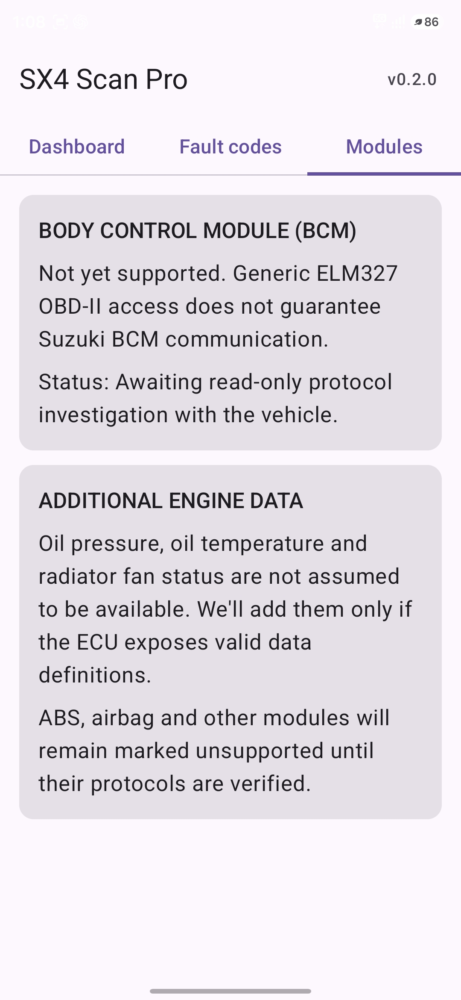

# SX4 Scan Pro — Developer Requirements & Project Decision Log

> **Purpose:** This is the canonical, AI-readable handover for developers and coding agents working on SX4 Scan Pro. Read it before changing code. Keep it current with every release and meaningful implementation change.
>
> **Last updated:** 2026-11-01  
> **Repository:** `mohammedshuaib8123-ui/SX4-Scan-Pro`  
> **Primary branch:** `main`  
> **Current UI label in source:** `v0.2.0 • UI PREVIEW • BUILD 10`  
> **Document status:** Living specification; requirements below distinguish confirmed requests, decisions, implemented foundations, and work still pending.

---

## 1. Product vision

Build a polished, tablet-first Android car head unit and OBD-II companion for the owner's **Indian-market 2012 Maruti Suzuki SX4 ZDi (1.3 DDiS diesel, manual)**.

The tablet is intended to be fitted flush into the SX4 dashboard, replacing/serving as the in-dash head unit and reusing the car's existing speakers where practical. The app should feel like a purpose-built automotive instrument cluster, not a generic phone app or a basic OBD reader.

The product has two related roles:

1. **SX4 Scan Pro / vehicle cockpit:** live engine information, diagnostics, alerts and a high-quality driving display.
2. **Head Unit:** a separate area for Android Auto receiver functionality, subject to technical and licensing feasibility.

The long-term goal is a stable, attractive, usable in-car system. Do not label unimplemented or unverified functionality as complete.

## 2. Target vehicle, hardware and environment

### Vehicle
- Indian-market 2012 Maruti Suzuki SX4 ZDi, 1.3 DDiS diesel.
- Manual transmission.
- Vehicle ECU/PID support must be verified on this actual vehicle; do not assume every generic OBD-II PID or Suzuki-specific module is available.

### Tablet
- Realme Pad 2, model RMP2204.
- Android 14.
- 11.5-inch display, 2000 × 1200 resolution.
- Design **landscape-first** and tablet-first.
- The UI must remain readable at the tablet's native resolution and must not clip, overlap, or truncate important information.

### OBD adapter
- Vgate iCar Pro Bluetooth 3.0.
- Classic Bluetooth / RFCOMM Serial Port Profile (SPP), not BLE.
- Adapter is already paired and known to work with the vehicle and other OBD apps.
- Use the standard SPP UUID where applicable: `00001101-0000-1000-8000-00805F9B34FB`.

### Development/build environment
- Native Android app, Kotlin and Jetpack Compose.
- GitHub repository and GitHub Actions are the current source/build workflow.
- Build debug APKs in CI and publish them as the `SX4-Scan-Pro-debug` workflow artifact.
- Java/JVM target must remain 17-aligned for Gradle builds.
- The previous JVM target mismatch was resolved by aligning Java and Kotlin targets to 17. Do not regress this.

## 3. Product and UX requirements

### 3.1 Overall visual direction — cockpit / gaming instrument cluster
The user explicitly wants a much more immersive and premium cockpit appearance. The early generic Material 3 cards and simple green semicircle gauges are not the desired final design.

Required direction:
- Full-screen or immersive dark cockpit presentation.
- Near-black / charcoal base.
- Cyan or blue instrument illumination.
- Amber for caution states.
- Red for critical states.
- Strong visual hierarchy, precise spacing and high-contrast typography.
- Large, immediately readable primary instruments.
- Professional OEM+ finish: clean, purposeful and not cluttered.
- Do not use random decorative effects that reduce readability.

### 3.2 Primary cockpit information
The driving/cockpit screen should prioritize:
- Engine RPM.
- Vehicle speed.
- Turbo/boost pressure, only when calculated from valid supported data.
- Coolant temperature.
- MAF airflow.
- Engine load.
- Other valid supported live parameters where they add value.

Secondary information can include:
- Intake air temperature.
- Manifold absolute pressure.
- Throttle position.
- Adapter/ECU connection state and data freshness.

Requirements:
- RPM and speed should be visually dominant (large instruments / prominent dial or equivalent cockpit treatment).
- Supporting readings should be grouped into clear information panels.
- Show units.
- Show unavailable or stale data honestly (for example, `—`, `Unavailable`, or `Stale`); never invent, interpolate or silently display a fabricated zero.
- Distinguish disconnected, connecting, connected-but-no-data, and live-data states.
- Ensure the display works in landscape on the Realme Pad 2 without overlap.

### 3.3 Navigation and screen structure
The intended top-level navigation is:
1. **Cockpit**
2. **Diagnostics**
3. **Head Unit**
4. **Settings**

The current source still has Dashboard / Fault codes / Modules tabs. This is an early structure and should be migrated to the intended navigation as the UI is redesigned.

### 3.4 Version/build label during development
- Show a visible app version and development/build marker on the UI in preview builds, so screenshots and APKs can be identified.
- Current source label: `v0.2.0 • UI PREVIEW • BUILD 10`.
- Keep a clear preview/development marker until the user explicitly approves the final build.
- Update version/build identifiers consistently with release/build policy; do not leave misleading stale labels.
- The UI label change is committed in source, but an APK containing it requires a subsequent successful Actions build.

### 3.5 Welcome / ignition-start announcement
On engine start, the app should play the custom welcome announcement:

**“Welcome to SX4 Airlines 2874”**

User-selected presentation:
- English.
- Calm female cockpit-style voice.
- Include a short airplane seat-belt warning-style chime/sound.
- Include the spoken announcement, warning sound and a dashboard visual flash/animation.

Implementation rules:
- This is an original custom sound/sequence; do not copy or extract a copyrighted airline recording.
- Female voice should use Android Text-to-Speech voice selection where available. Provide a sensible fallback if the device does not expose a suitable female English voice.
- Detect engine start from valid engine RPM becoming greater than zero, not merely from Bluetooth connection.
- Debounce start detection to avoid repeated announcements from noisy readings.
- Play once per engine-start event.
- Re-arm only after RPM has returned to zero / engine-off state for a suitable sustained interval.
- Do not announce on app launch, adapter connect, or reconnect if the engine-start event was not newly detected.
- Suppress the event when RPM is unavailable, invalid or stale.
- Audio focus and volume behavior must be handled responsibly.

### 3.6 Vehicle alerts and warnings
The user wants:
- Spoken warning announcements.
- Warning/chime sounds.
- A visible dashboard flash/visual warning state.

Safety and correctness:
- Only generate alerts from valid, supported, fresh ECU data.
- No alerts based on missing, stale, malformed or guessed values.
- Use sensible debounce, hysteresis and cooldown to prevent repeated warning spam.
- Separate caution (amber) and critical (red) severity.
- Do not invent thresholds. Any threshold must be justified by a verified vehicle specification or explicitly documented configurable choice.
- Do not imply the app replaces factory warning lamps, ECU protection, the instrument cluster or driver attention.
- Warnings must supplement, not replace, factory warnings.
- Avoid distracting animations or long spoken messages while driving; prioritize concise alerts.
- Keep the user informed when a warning feature is unavailable because the ECU does not expose the required data.

## 4. OBD-II and diagnostics requirements

### 4.1 Connection and adapter handling
- Connect to the already paired Vgate iCar Pro Bluetooth Classic adapter.
- Request and handle Android Bluetooth permissions correctly, including Android 12+ Nearby devices / Bluetooth Connect permission.
- Provide clear pairing, permission, adapter-off, connection-failed and disconnected guidance.
- Prefer paired devices matching Vgate / iCar / OBD names, but do not silently connect to an unrelated Bluetooth device if a better selection UI is needed.
- Provide explicit connect, reconnect and disconnect controls.
- Handle socket failures, timeouts, app backgrounding, activity destruction and reconnects without leaking sockets or leaving stale live values on screen.
- Do not block the UI thread with Bluetooth I/O.
- Serialize ELM327 commands; avoid interleaved request/response traffic.

### 4.2 ELM327 initialization and protocol
Current initialization sequence in source:
- `ATZ`
- `ATE0`
- `ATL0`
- `ATS0`
- `ATH0`
- `ATSP0`

This is a starter sequence, not a guarantee of protocol correctness. Improve it with robust response validation, adapter identification and protocol reporting. Handle `NO DATA`, `? `, `UNABLE TO CONNECT`, malformed frames, timeouts and partial responses explicitly.

### 4.3 Supported standard live PIDs
The current code requests these standard OBD-II PIDs:
- `010C` — engine RPM.
- `010D` — vehicle speed.
- `0105` — engine coolant temperature.
- `010F` — intake air temperature.
- `010B` — intake manifold absolute pressure.
- `0110` — mass air flow.
- `0104` — calculated engine load.
- `0111` — throttle position.
- `0133` — barometric pressure, currently used for a boost estimate if returned.

PID availability must be discovered from ECU-supported PID bitmaps (and subsequent bitmap ranges where applicable) before polling unsupported PIDs repeatedly. The current source does not yet implement full supported-PID discovery.

### 4.4 Boost calculation
- Display boost only when both manifold absolute pressure (MAP) and barometric pressure are valid and fresh.
- Basic gauge boost estimate: `MAP - BARO`.
- Clamp negative gauge boost to zero for a conventional boost gauge, but retain raw values if useful for diagnostics.
- Confirm units and conversion before display.
- Never label MAP itself as turbo boost.
- Do not display a boost number if BARO is missing or invalid.
- Diesel ECU behavior and actual SX4 readings must be validated on the vehicle.

### 4.5 Parsing and data quality
The current parser is a basic implementation and needs hardening.
- Parse complete ELM response frames, not arbitrary substrings.
- Validate service/mode and PID response headers.
- Validate byte counts before conversion.
- Handle headers on/off, spaces on/off, line feeds on/off, prompt termination, echoed commands, multi-frame responses and adapter-specific formatting.
- Avoid treating malformed/empty response bytes as valid zero values.
- Keep raw response logging available for development diagnostics, with privacy-conscious controls.
- Use correct PID formulas and units.
- Add tests for valid, partial, malformed, negative and no-data responses.
- Poll at a stable rate that does not overload the adapter/ECU; current loop is approximately 1.1 seconds for a full dashboard cycle and should be optimized only after measuring reliability.

### 4.6 Diagnostic trouble codes (DTC)
Current source attempts read-only scans of:
- Mode 03 — stored codes.
- Mode 07 — pending codes.
- Mode 0A — permanent codes.

Requirements:
- Keep code reading read-only initially.
- Correctly decode DTC bytes and associate the code with the ECU/module actually queried.
- Show scan progress, timestamp, result and clear no-data/unsupported messages.
- An empty result must not be presented as proof that the entire vehicle is fault-free.
- Do not add code clearing, resets, actuator tests or write commands without a separate explicit requirement, risk review and confirmation.
- Current implementation only queries the engine ECU through generic OBD-II; do not imply full-vehicle coverage.

### 4.7 Suzuki-specific modules / BCM
The user wants to investigate additional Suzuki-specific module access, especially BCM.
- BCM is not currently implemented.
- Generic ELM327 OBD-II access does not guarantee BCM access.
- ABS, airbags, immobilizer, BCM and other body/chassis modules must be marked unsupported until communication is verified.
- Investigate protocol/addressing and adapter hardware capability safely and read-only first.
- Do not send undocumented write/configuration commands.
- Do not claim module support based only on a menu item or a successful generic OBD connection.

### 4.8 Other desired/considered readings
Potential additional data includes:
- Oil pressure.
- Oil temperature.
- Radiator cooling fan status.
- Other Suzuki-specific engine/body information.

These are **conditional**, not guaranteed requirements: add only if a verified ECU PID/sensor/data definition exists and the SX4 actually supplies valid data. Clearly mark unsupported items rather than fabricating readings.

## 5. Android Auto / Head Unit page

The user wants Android Auto receiver functionality available as a separate page/area within the same app, alongside SX4 Scan Pro features.

Important technical decision already discussed:
- A normal Android tablet app cannot simply declare itself a native Android Auto receiver. In the usual projection model, Android Auto runs on the phone and projects to compatible receiver/head-unit software.
- Open-source **Open Headunit** (project by andreknieriem) was identified as a possible foundation for tablet receiver functionality.
- Wired USB projection was considered the more practical first validation target; wireless behavior is more complex and may be affected by Android Auto version changes.
- Open Headunit is AGPL-3.0. If its code is incorporated or modified and distributed, comply with the applicable AGPL source-disclosure and license obligations. Non-commercial use does not automatically remove distribution obligations.
- Do not copy proprietary Android Auto code or reverse engineer beyond applicable legal/licensing permissions.
- Before integration, verify Realme Pad 2 USB OTG/host capability, phone compatibility, audio routing to existing car speakers, display sizing, touch input and lifecycle.
- Keep the Head Unit area separate from OBD cockpit/diagnostics so one feature cannot break the other.
- No Android Auto receiver integration is currently implemented.

## 6. Audio and in-car integration

- The tablet is intended to act as the car's head unit and use the existing SX4 speakers where practical.
- Evaluate audio routing and output latency/quality on the actual tablet and vehicle installation.
- Ensure the welcome announcement and warning sounds can be heard clearly without unexpectedly changing system volume.
- Avoid interfering with other audio sources.
- Consider audio focus, interruption/resume behavior and startup timing.
- Do not assume the tablet's built-in speaker is the final audio output.

## 7. Safety, reliability and UX constraints

- The app is an informational companion, not a certified automotive diagnostic or safety system.
- Do not instruct or encourage the driver to operate the tablet while driving. Configuration, diagnostics and interaction should be done while parked or by a passenger.
- Never suppress, replace or contradict factory warning indicators.
- Never invent unsupported values, DTCs, module availability or warning thresholds.
- Display data age/freshness or otherwise clearly invalidate stale values after disconnect or polling failure.
- Recover cleanly from Bluetooth disconnects, adapter power loss, app backgrounding and tablet sleep/wake.
- Prefer predictable, stable behavior over flashy features.
- Avoid over-investigation and speculative diagnosis; only report evidence-supported findings.
- Do not modify unrelated repositories. The old `Scanner-v2` repository must remain untouched; all work belongs in `SX4-Scan-Pro`.

## 8. Current repository implementation snapshot

This section records what was observed in source on 2026-11-01. It is not a claim that these features have passed real-vehicle validation.

### Implemented foundation (source present)
- Kotlin Android application using Jetpack Compose / Material 3.
- Package/namespace: `com.sx4scanpro`.
- Bluetooth Classic SPP socket connection to a paired adapter.
- Basic Android 12+ Bluetooth Connect permission request.
- Basic ELM initialization commands.
- Basic polling and parsing for the listed standard live PIDs.
- Basic MAP minus BARO boost estimate when BARO is returned.
- Basic DTC scan requests for Modes 03, 07 and 0A.
- Explicit UI notes that BCM and other modules are unsupported.
- Basic connect/reconnect/disconnect controls.
- GitHub Actions debug APK build and artifact upload.
- Version/preview/build label in the top app bar source: `v0.2.0 • UI PREVIEW • BUILD 10`.

### Present but requires validation/hardening
- Bluetooth device selection currently prefers a paired name containing Vgate, iCar or OBD, otherwise falls back to the first paired device. This fallback may select an unrelated device and should be improved.
- ELM command reader uses a prompt timeout and simple character collection. It requires robust framing and parsing.
- PID parser uses basic byte extraction and formulas; it does not yet perform complete supported-PID discovery.
- DTC decoder is basic and must be tested against real ECU responses and edge cases.
- Current gauge cards are generic small semicircle gauges, not the requested final cockpit instruments.
- Current navigation is Dashboard / Fault codes / Modules, not the intended Cockpit / Diagnostics / Head Unit / Settings.
- Current code has not been validated against the actual SX4 in this development session because the vehicle was not available for live testing.

### Not implemented yet
- Final immersive landscape cockpit UI and large primary RPM/speed instruments.
- New four-section navigation.
- Robust PID bitmap discovery and protocol reporting.
- Hardened ELM response parser and automated parser tests.
- Data freshness/staleness model and robust reconnect lifecycle.
- Validated full DTC presentation.
- Suzuki-specific BCM / ABS / airbag / immobilizer communication.
- Verified extra oil/fan data.
- Engine-start RPM detection and “Welcome to SX4 Airlines 2874” voice/chime sequence.
- Caution/critical voice and visual warning engine.
- Android Auto receiver / Open Headunit integration.
- Final audio routing/in-car installation validation.
- Final release branding and removal of preview marker after user approval.

## 9. Build, versioning and release process

### Current CI
Workflow: `.github/workflows/android.yml`
- Trigger: push to `main` or manual workflow dispatch.
- Runner: `ubuntu-latest`.
- Java: Temurin 17.
- Gradle: 8.9.
- Build command: `gradle assembleDebug`.
- Artifact: `SX4-Scan-Pro-debug`.
- Artifact retention: 14 days.

### Release discipline
For every meaningful release:
1. Update implementation and tests.
2. Update this document in the same release/change set.
3. Record the version/build identifier and a concise change log.
4. Run the GitHub Actions build.
5. Confirm the workflow is green and the APK artifact exists before saying an APK is ready.
6. Report the exact run/artifact and any known limitations.
7. Keep the preview marker until the user approves the final build.

Do not state that a source commit means an APK has been built. A source change only appears in the downloadable APK after a successful build from that commit.

### Release history
| Date | Version / label | Change | Verification |
|---|---|---|---|
| 2026-10-31 | Early starter / build 9 artifact | Kotlin/Compose app, basic Bluetooth OBD connection, live standard PID dashboard, basic DTC modes, GitHub Actions APK artifact. | GitHub Actions run #9 succeeded; debug artifact was available. Not a validated vehicle release. |
| 2026-11-01 | `v0.2.0 • UI PREVIEW • BUILD 10` source label | Added visible preview/version/build label to top bar. | GitHub Actions run #14 succeeded for the version-label commit. Run #15 also succeeded for the documentation commit. Neither success proves real-vehicle validation. |

## 10. Screenshot and visual feedback workflow

- The user wants to provide screenshots by uploading them into the repository when direct chat attachment limits are reached.
- Screenshot folder: `docs/screenshots/`.
- Screenshot currently present in the repository: `docs/screenshots/Screenshot_20261101_010815.jpg`.

### Current uploaded screenshot

[Open the original screenshot file](screenshots/Screenshot_20261101_010815.jpg).

- The repository confirms that this image file exists (401,677 bytes). In the current review session, the GitHub file reader could list the JPG but could not decode its binary contents. Therefore, no visual assessment of this specific screenshot is claimed yet.
- When a screenshot is visually accessible, assess layout, clipping, hierarchy, typography, colors and tablet landscape fit. Record actionable feedback and resulting changes here.
- Add each new review screenshot to this folder and embed it here with a short date/build caption. Keep older screenshots so visual progress can be compared over time.

## 11. Development priorities / suggested implementation sequence

Prioritize in this order unless the user changes direction:

1. **UI foundation:** redesign landscape tablet cockpit; remove overlap/clipping; large RPM/speed instruments; clear live-data panels; intended navigation; visible preview/build label.
2. **OBD reliability:** supported PID discovery, robust ELM framing/parsing, correct units/formulas, data freshness and safe reconnect.
3. **Diagnostics:** harden read-only DTC scanning and clear module coverage disclosure.
4. **Engine-start experience:** RPM-based start detection, custom chime, calm female English TTS welcome, visual flash and anti-repeat logic.
5. **Warnings:** verified thresholds only, valid/fresh data only, debounce/hysteresis/cooldowns, caution/critical presentation.
6. **Head Unit:** evaluate Open Headunit integration, licensing, OTG and wired Android Auto prototype in an isolated module/page.
7. **Vehicle validation:** test with the actual SX4 and Vgate adapter; document observed ECU support and known limitations.
8. **Release polish:** audio routing, lifecycle, performance, final branding and user approval.

## 12. Acceptance criteria for final product

A feature is not complete merely because a screen or button exists. Mark it complete only when the relevant criteria are met.

### Cockpit UI
- Landscape Realme Pad 2 layout has no clipped, overlapping or unreadable content.
- RPM and speed are dominant and glance-readable.
- Dark cockpit visual language is consistent and polished.
- All live readings show correct units and unavailable/stale states.
- Navigation matches the agreed four sections.

### OBD
- Connects reliably to the paired Vgate iCar Pro Classic adapter.
- Handles permissions, reconnects, disconnects and app lifecycle.
- Supported PIDs are discovered and only valid values are shown.
- PID parsing/formulas are covered by tests and verified against real responses.
- MAP/BARO boost is only shown when both values are valid.
- DTC results accurately state which ECU/modes were scanned.

### Welcome and alerts
- Engine-start announcement triggers only on a new, validated RPM transition.
- Plays the exact requested phrase with calm female English voice where available.
- Original chime and dashboard visual effect play as designed.
- No repeat announcements from reconnects/noisy readings.
- Warnings only use verified thresholds and fresh supported data.

### Head Unit
- Android Auto receiver approach is technically and legally reviewed.
- Wired projection works on the target tablet/phone before wireless is attempted.
- Audio and touch routing work in the installed car setup.
- Open-source license obligations are met.

### Release
- CI build succeeds.
- APK artifact is confirmed and linked.
- Version/build marker matches the delivered build.
- This document is updated in the same release.

## 13. Instructions for future AI coding agents

When continuing this repository:
- Read this document first, then inspect the current source before making assumptions.
- Treat user-confirmed requirements as authoritative.
- Keep the implementation native Android/Kotlin/Compose unless the user approves a change.
- Target Realme Pad 2 landscape use first.
- Preserve the existing SX4/Vgate Classic Bluetooth context.
- Make changes in small, buildable steps; do not claim a feature works without test/build evidence.
- Prefer read-only vehicle communication until explicitly approved otherwise.
- Do not fabricate PIDs, DTCs, warning thresholds, ECU/module support or build status.
- Keep user-facing labels and the release/version marker synchronized.
- Update this file whenever requirements, architecture decisions, implemented behavior, limitations, or release status change.
- Never modify the unrelated `Scanner-v2` repository.

---

## 14. Change log for this document

- **2026-11-01:** Initial consolidated developer/AI handover created from project requirements, decisions and current source inspection. Includes target hardware, cockpit UI, OBD-II, diagnostics, welcome announcement, warning behavior, Android Auto investigation, safety constraints, implementation snapshot, CI/release workflow and acceptance criteria.
- **2026-11-01:** Embedded the uploaded current-UI screenshot in this document and recorded the image-inspection limitation. Updated build history after confirming Actions runs #14 and #15 succeeded.
