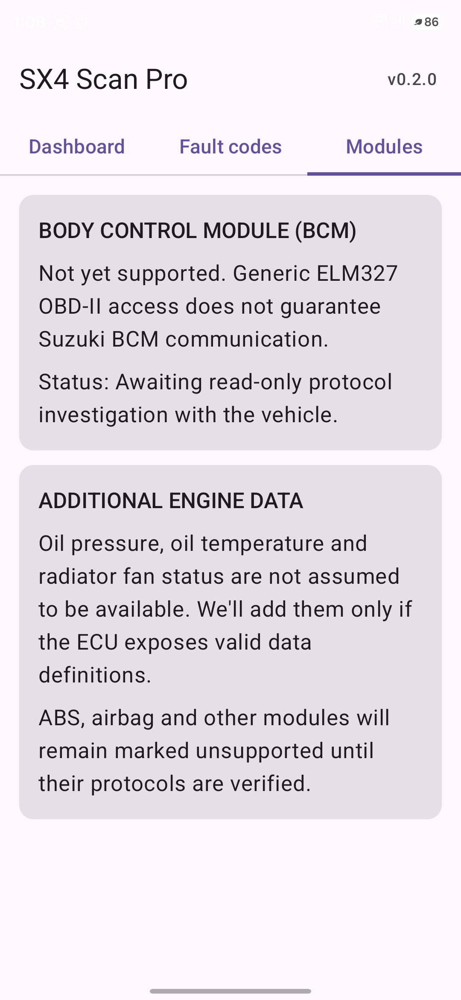

# SX4 Scan Pro — Developer Requirements & Project Decision Log

> **Purpose:** This is the canonical, AI-readable handover for developers and coding agents working on SX4 Scan Pro. Read it before changing code. Keep it current with every release and meaningful implementation change.
>
> **Last updated:** 2026-11-01  
> **Repository:** `mohammedshuaib8123-ui/SX4-Scan-Pro`  
> **Primary branch:** `main`  
> **Current UI label in source:** `v0.3.5 • UI PREVIEW • BUILD 16`  
> **Document status:** Living specification; requirements below distinguish confirmed requests, decisions, implemented foundations, and work still pending.

---

## 1. Product vision

Build a polished, tablet-first Android car head unit and OBD-II companion for the owner's **Indian-market 2012 Maruti Suzuki SX4 ZDi (1.3 DDiS diesel, manual)**.

The tablet is intended to be fitted flush into the SX4 dashboard, replacing/serving as the in-dash head unit and reusing the car's existing speakers where practical. The app should feel like a purpose-built automotive instrument cluster, not a generic phone app or a basic OBD reader.

The product has two related roles:

1. **SX4 Scan Pro / vehicle cockpit:** live engine information, diagnostics, alerts and a high-quality driving display.
2. **Head Unit:** a separate area for Android Auto receiver functionality, subject to technical and licensing feasibility.

The long-term goal is a stable, attractive, usable in-car system. Do not label unimplemented or unverified functionality as complete.

## 2. Target vehicle, hardware and environment

### Vehicle
- Indian-market 2012 Maruti Suzuki SX4 ZDi, 1.3 DDiS diesel.
- Manual transmission.
- Vehicle ECU/PID support must be verified on this actual vehicle; do not assume every generic OBD-II PID or Suzuki-specific module is available.

### Tablet
- Realme Pad 2, model RMP2204.
- Android 14.
- 11.5-inch display, 2000 × 1200 resolution.
- Design **landscape-first** and tablet-first.
- The UI must remain readable at the tablet's native resolution and must not clip, overlap, or truncate important information.

### OBD adapter
- Vgate iCar Pro Bluetooth 3.0.
- Classic Bluetooth / RFCOMM Serial Port Profile (SPP), not BLE.
- Adapter is already paired and known to work with the vehicle and other OBD apps.
- Use the standard SPP UUID where applicable: `00001101-0000-1000-8000-00805F9B34FB`.

### Development/build environment
- Native Android app, Kotlin and Jetpack Compose.
- GitHub repository and GitHub Actions are the current source/build workflow.
- Build debug APKs in CI and publish them as the `SX4-Scan-Pro-debug` workflow artifact.
- Java/JVM target must remain 17-aligned for Gradle builds.
- The previous JVM target mismatch was resolved by aligning Java and Kotlin targets to 17. Do not regress this.

## 3. Product and UX requirements

### 3.1 Overall visual direction — cockpit / gaming instrument cluster
The user explicitly wants a much more immersive and premium cockpit appearance. The early generic Material 3 cards and simple green semicircle gauges are not the desired final design.

Required direction:
- Full-screen or immersive dark cockpit presentation.
- Near-black / charcoal base.
- Cyan or blue instrument illumination.
- Amber for caution states.
- Red for critical states.
- Strong visual hierarchy, precise spacing and high-contrast typography.
- Large, immediately readable primary instruments.
- Professional OEM+ finish: clean, purposeful and not cluttered.
- Do not use random decorative effects that reduce readability.

### 3.2 Primary cockpit information
The driving/cockpit screen should prioritize:
- Engine RPM.
- Vehicle speed.
- Turbo/boost pressure, only when calculated from valid supported data.
- Coolant temperature.
- MAF airflow.
- Engine load.
- Other valid supported live parameters where they add value.

Secondary information can include:
- Intake air temperature.
- Manifold absolute pressure.
- Throttle position.
- Adapter/ECU connection state and data freshness.

Requirements:
- RPM and speed should be visually dominant (large instruments / prominent dial or equivalent cockpit treatment).
- Supporting readings should be grouped into clear information panels.
- Show units.
- Show unavailable or stale data honestly (for example, `—`, `Unavailable`, or `Stale`); never invent, interpolate or silently display a fabricated zero.
- Distinguish disconnected, connecting, connected-but-no-data, and live-data states.
- Ensure the display works in landscape on the Realme Pad 2 without overlap.

### 3.3 Navigation and screen structure
The intended top-level navigation is:
1. **Cockpit**
2. **Diagnostics**
3. **Head Unit**
4. **Settings**

The current source still has Dashboard / Fault codes / Modules tabs. This is an early structure and should be migrated to the intended navigation as the UI is redesigned.

### 3.4 Version/build label during development
- Show a visible app version and development/build marker on the UI in preview builds, so screenshots and APKs can be identified.
- Current source label: `v0.2.0 • UI PREVIEW • BUILD 10`.
- Keep a clear preview/development marker until the user explicitly approves the final build.
- Update version/build identifiers consistently with release/build policy; do not leave misleading stale labels.
- The UI label change is committed in source, but an APK containing it requires a subsequent successful Actions build.

### 3.5 Welcome / ignition-start announcement
On engine start, the app should play the custom welcome announcement:

**“Welcome to SX4 Airlines 2874”**

User-selected presentation:
- English.
- Calm female cockpit-style voice.
- Include a short airplane seat-belt warning-style chime/sound.
- Include the spoken announcement, warning sound and a dashboard visual flash/animation.

Implementation rules:
- This is an original custom sound/sequence; do not copy or extract a copyrighted airline recording.
- Female voice should use Android Text-to-Speech voice selection where available. Provide a sensible fallback if the device does not expose a suitable female English voice.
- Detect engine start from valid engine RPM becoming greater than zero, not merely from Bluetooth connection.
- Debounce start detection to avoid repeated announcements from noisy readings.
- Play once per engine-start event.
- Re-arm only after RPM has returned to zero / engine-off state for a suitable sustained interval.
- Do not announce on app launch, adapter connect, or reconnect if the engine-start event was not newly detected.
- Suppress the event when RPM is unavailable, invalid or stale.
- Audio focus and volume behavior must be handled responsibly.

### 3.6 Vehicle alerts and warnings
The user wants:
- Spoken warning announcements.
- Warning/chime sounds.
- A visible dashboard flash/visual warning state.

Safety and correctness:
- Only generate alerts from valid, supported, fresh ECU data.
- No alerts based on missing, stale, malformed or guessed values.
- Use sensible debounce, hysteresis and cooldown to prevent repeated warning spam.
- Separate caution (amber) and critical (red) severity.
- Do not invent thresholds. Any threshold must be justified by a verified vehicle specification or explicitly documented configurable choice.
- Do not imply the app replaces factory warning lamps, ECU protection, the instrument cluster or driver attention.
- Warnings must supplement, not replace, factory warnings.
- Avoid distracting animations or long spoken messages while driving; prioritize concise alerts.
- Keep the user informed when a warning feature is unavailable because the ECU does not expose the required data.

## 4. OBD-II and diagnostics requirements

### 4.1 Connection and adapter handling
- Connect to the already paired Vgate iCar Pro Bluetooth Classic adapter.
- Request and handle Android Bluetooth permissions correctly, including Android 12+ Nearby devices / Bluetooth Connect permission.
- Provide clear pairing, permission, adapter-off, connection-failed and disconnected guidance.
- Prefer paired devices matching Vgate / iCar / OBD names, but do not silently connect to an unrelated Bluetooth device if a better selection UI is needed.
- Provide explicit connect, reconnect and disconnect controls.
- Handle socket failures, timeouts, app backgrounding, activity destruction and reconnects without leaking sockets or leaving stale live values on screen.
- Do not block the UI thread with Bluetooth I/O.
- Serialize ELM327 commands; avoid interleaved request/response traffic.
- If a command times out or the stream becomes ambiguous, invalidate and close the socket rather than sending another command that could consume a late reply. First ECU PID discovery uses an extended timeout. This is a defensive foundation, not a substitute for real K-line/CAN timing validation.

### 4.2 ELM327 initialization and protocol
Current initialization sequence in source:
- `ATZ`
- `ATE0`
- `ATL0`
- `ATS0`
- `ATH0`
- `ATSP0`

This is a starter sequence, not a guarantee of protocol correctness. Improve it with robust response validation, adapter identification and protocol reporting. Handle `NO DATA`, `? `, `UNABLE TO CONNECT`, malformed frames, timeouts and partial responses explicitly.

### 4.3 Supported standard live PIDs
The current code requests these standard OBD-II PIDs:
- `010C` — engine RPM.
- `010D` — vehicle speed.
- `0105` — engine coolant temperature.
- `010F` — intake air temperature.
- `010B` — intake manifold absolute pressure.
- `0110` — mass air flow.
- `0104` — calculated engine load.
- `0111` — throttle position.
- `0133` — barometric pressure, currently used for a boost estimate if returned.

PID availability must be discovered from ECU-supported PID bitmaps (and subsequent bitmap ranges where applicable) before polling unsupported PIDs repeatedly. The current source does not yet implement full supported-PID discovery.

### 4.4 Boost calculation
- Display boost only when both manifold absolute pressure (MAP) and barometric pressure are valid and fresh.
- Basic gauge boost estimate: `MAP - BARO`.
- Clamp negative gauge boost to zero for a conventional boost gauge, but retain raw values if useful for diagnostics.
- Confirm units and conversion before display.
- Never label MAP itself as turbo boost.
- Do not display a boost number if BARO is missing or invalid.
- Diesel ECU behavior and actual SX4 readings must be validated on the vehicle.

### 4.5 Parsing and data quality
The current parser is a basic implementation and needs hardening.
- Parse complete ELM response frames, not arbitrary substrings.
- Validate service/mode and PID response headers.
- Validate byte counts before conversion.
- Handle headers on/off, spaces on/off, line feeds on/off, prompt termination, echoed commands, multi-frame responses and adapter-specific formatting.
- Avoid treating malformed/empty response bytes as valid zero values.
- Keep raw response logging available for development diagnostics, with privacy-conscious controls.
- Use correct PID formulas and units.
- Add tests for valid, partial, malformed, negative and no-data responses.
- Poll at a stable rate that does not overload the adapter/ECU; current loop is approximately 1.1 seconds for a full dashboard cycle and should be optimized only after measuring reliability.

### 4.6 Diagnostic trouble codes (DTC)
Current source attempts read-only scans of:
- Mode 03 — stored codes.
- Mode 07 — pending codes.
- Mode 0A — permanent codes.

Requirements:
- Keep code reading read-only initially.
- Correctly decode DTC bytes and associate the code with the ECU/module actually queried.
- Show scan progress, timestamp, result and clear no-data/unsupported messages.
- An empty result must not be presented as proof that the entire vehicle is fault-free.
- Do not add code clearing, resets, actuator tests or write commands without a separate explicit requirement, risk review and confirmation.
- Current implementation only queries the engine ECU through generic OBD-II; do not imply full-vehicle coverage.

### 4.7 Suzuki-specific modules / BCM
The user wants to investigate additional Suzuki-specific module access, especially BCM.
- BCM is not currently implemented.
- Generic ELM327 OBD-II access does not guarantee BCM access.
- ABS, airbags, immobilizer, BCM and other body/chassis modules must be marked unsupported until communication is verified.
- Investigate protocol/addressing and adapter hardware capability safely and read-only first.
- Do not send undocumented write/configuration commands.
- Do not claim module support based only on a menu item or a successful generic OBD connection.

### 4.8 Other desired/considered readings
Potential additional data includes:
- Oil pressure.
- Oil temperature.
- Radiator cooling fan status.
- Other Suzuki-specific engine/body information.

These are **conditional**, not guaranteed requirements: add only if a verified ECU PID/sensor/data definition exists and the SX4 actually supplies valid data. Clearly mark unsupported items rather than fabricating readings.

## 5. Android Auto / Head Unit page

The user wants Android Auto receiver functionality available as a separate page/area within the same app, alongside SX4 Scan Pro features.

Important technical decision already discussed:
- A normal Android tablet app cannot simply declare itself a native Android Auto receiver. In the usual projection model, Android Auto runs on the phone and projects to compatible receiver/head-unit software.
- Open-source **Open Headunit** (project by andreknieriem) was identified as a possible foundation for tablet receiver functionality.
- Wired USB projection was considered the more practical first validation target; wireless behavior is more complex and may be affected by Android Auto version changes.
- Open Headunit is AGPL-3.0. If its code is incorporated or modified and distributed, comply with the applicable AGPL source-disclosure and license obligations. Non-commercial use does not automatically remove distribution obligations.
- Do not copy proprietary Android Auto code or reverse engineer beyond applicable legal/licensing permissions.
- Before integration, verify Realme Pad 2 USB OTG/host capability, phone compatibility, audio routing to existing car speakers, display sizing, touch input and lifecycle.
- Keep the Head Unit area separate from OBD cockpit/diagnostics so one feature cannot break the other.
- No Android Auto receiver integration is currently implemented.

## 6. Audio and in-car integration

- The tablet is intended to act as the car's head unit and use the existing SX4 speakers where practical.
- Evaluate audio routing and output latency/quality on the actual tablet and vehicle installation.
- Ensure the welcome announcement and warning sounds can be heard clearly without unexpectedly changing system volume.
- Avoid interfering with other audio sources.
- Consider audio focus, interruption/resume behavior and startup timing.
- Do not assume the tablet's built-in speaker is the final audio output.

## 7. Safety, reliability and UX constraints

- The app is an informational companion, not a certified automotive diagnostic or safety system.
- Do not instruct or encourage the driver to operate the tablet while driving. Configuration, diagnostics and interaction should be done while parked or by a passenger.
- Never suppress, replace or contradict factory warning indicators.
- Never invent unsupported values, DTCs, module availability or warning thresholds.
- Display data age/freshness or otherwise clearly invalidate stale values after disconnect or polling failure.
- Recover cleanly from Bluetooth disconnects, adapter power loss, app backgrounding and tablet sleep/wake.
- Prefer predictable, stable behavior over flashy features.
- Avoid over-investigation and speculative diagnosis; only report evidence-supported findings.
- Do not modify unrelated repositories. The old `Scanner-v2` repository must remain untouched; all work belongs in `SX4-Scan-Pro`.

## 8. Current repository implementation snapshot

This section records what was observed in source on 2026-11-01. It is not a claim that these features have passed real-vehicle validation.

### Implemented foundation (source present)
- Kotlin Android application using Jetpack Compose / Material 3.
- Package/namespace: `com.sx4scanpro`.
- Bluetooth Classic SPP socket connection to a paired adapter.
- Basic Android 12+ Bluetooth Connect permission request.
- Basic ELM initialization commands.
- Basic polling and parsing for the listed standard live PIDs.
- Basic MAP minus BARO boost estimate when BARO is returned.
- Basic DTC scan requests for Modes 03, 07 and 0A.
- Explicit UI notes that BCM and other modules are unsupported.
- Basic connect/reconnect/disconnect controls.
- GitHub Actions debug APK build and artifact upload.
- Four-section Compose UI (Cockpit / Diagnostics / Head Unit / Settings) with first-pass landscape cockpit gauges.\n- Visible source label: `v0.3.4 • UI PREVIEW • BUILD 15`.

### Present but requires validation/hardening
- Bluetooth selection requires exactly one paired device whose name contains Vgate, iCar or OBD; zero or multiple matches fail safely. This name match is a guardrail, not cryptographic adapter identification.
- ELM command reader uses a prompt timeout and simple character collection. It requires robust framing and parsing.
- PID parser uses basic byte extraction and formulas; it does not yet perform complete supported-PID discovery.
- DTC decoder is basic and must be tested against real ECU responses and edge cases.
- The cockpit now has a more aggressive instrument treatment: layered dark gradient, cyan/amber accents, brighter dial rings, tick marks, centre hub and needle. This is an improved preview, not final visual sign-off; tablet screenshot review remains required.
- The four-section navigation exists, but its current visual treatment is still a minimal first pass and does not meet the desired gaming-style cockpit finish.
- Current code has not been validated against the actual SX4 in this development session because the vehicle was not available for live testing.

### Not implemented yet
- Final immersive landscape cockpit UI and large primary RPM/speed instruments.
- New four-section navigation.
- Robust PID bitmap discovery and protocol reporting.
- Hardened ELM response parser and automated parser tests.
- Data freshness/staleness model and robust reconnect lifecycle.
- Validated full DTC presentation.
- Suzuki-specific BCM / ABS / airbag / immobilizer communication.
- Verified extra oil/fan data.
- Engine-start RPM detection and “Welcome to SX4 Airlines 2874” voice/chime sequence (implemented in source with offline debounce tests; actual TTS voice/audio and vehicle trigger remain to be checked on-device).
- Caution/critical voice and visual warning engine.
- Android Auto receiver / Open Headunit integration.
- Final audio routing/in-car installation validation.
- Final release branding and removal of preview marker after user approval.

## 9. Build, versioning and release process

### Current CI
Workflow: `.github/workflows/android.yml`
- Trigger: push to `main` or manual workflow dispatch.
- Runner: `ubuntu-latest`.
- Java: Temurin 17.
- Gradle: 8.9.
- Build command: `gradle assembleDebug`.
- Artifact: `SX4-Scan-Pro-debug`.
- Artifact retention: 14 days.

### Release discipline
For every meaningful release:
1. Update implementation and tests.
2. Update this document in the same release/change set.
3. Record the version/build identifier and a concise change log.
4. Run the GitHub Actions build.
5. Confirm the workflow is green and the APK artifact exists before saying an APK is ready.
6. Report the exact run/artifact and any known limitations.
7. Keep the preview marker until the user approves the final build.

Do not state that a source commit means an APK has been built. A source change only appears in the downloadable APK after a successful build from that commit.

### Release history
| Date | Version / label | Change | Verification |
|---|---|---|---|
| 2026-10-31 | Early starter / build 9 artifact | Kotlin/Compose app, basic Bluetooth OBD connection, live standard PID dashboard, basic DTC modes, GitHub Actions APK artifact. | GitHub Actions run #9 succeeded; debug artifact was available. Not a validated vehicle release. |
| 2026-11-01 | `v0.2.0 • UI PREVIEW • BUILD 10` source label | Added visible preview/version/build label to top bar. | GitHub Actions run #14 succeeded for the version-label commit. Run #15 also succeeded for the documentation commit. Neither success proves real-vehicle validation. |

## 10. Screenshot and visual feedback workflow

- The user wants to provide screenshots by uploading them into the repository when direct chat attachment limits are reached.
- Screenshot folder: `docs/screenshots/`.
- Screenshot currently present in the repository: `docs/screenshots/Screenshot_20261101_010815.jpg`.

### User-uploaded application screenshot (not the concept mockups)

[Open the original uploaded application screenshot](screenshots/Screenshot_20261101_010815.jpg).

**Important distinction:** this is the user's uploaded screenshot of the existing application. It is not one of the previously presented cockpit / diagnostics / head-unit concept mockups. Do not treat it as the target visual design or as evidence that the cockpit design is implemented.

### Target screen concepts to recreate in the application

The earlier visual concepts are the design target, and must be recreated as actual Compose screens rather than substituted with the uploaded app screenshot.

1. **Cockpit / home screen:** full-bleed near-black graphite background; restrained neon-cyan instrument illumination; large circular RPM dial and speed dial as the visual anchors; subtle illuminated arcs / tick marks / needle treatment; compact telemetry panels for boost, coolant, MAF and engine load; amber caution and red critical states; a clear ECU connection indicator; landscape tablet composition with no clipping.
2. **Diagnostics screen:** same dark visual language; clear engine ECU scan area; stored / pending / permanent DTC groups; scan progress and timestamp; separate module tiles for BCM, ABS, airbag and immobilizer with explicit unsupported / not verified states until real communication is proven.
3. **Head Unit screen:** a separate, uncluttered receiver launch / connection surface, with wired Android Auto as the first integration target. It must not imply Android Auto is working until the receiver module is actually integrated and tested.
4. **Settings screen:** adapter selection and connection controls, sound / welcome preferences, display and brightness options, diagnostic data freshness / protocol information, and build/version identification.

**Visual review rule:** when the earlier generated concept images are available in chat history or re-uploaded, attach those exact concept references here as separate files. Do not rename the user's existing screenshot or present a newly invented generic image as an original prior mockup.

- The repository confirms that this image file exists (401,677 bytes). In the current review session, the GitHub file reader could list the JPG but could not decode its binary contents. Therefore, no visual assessment of this specific screenshot is claimed yet.
- When a screenshot is visually accessible, assess layout, clipping, hierarchy, typography, colors and tablet landscape fit. Record actionable feedback and resulting changes here.
- Add each new review screenshot to this folder and embed it here with a short date/build caption. Keep older screenshots so visual progress can be compared over time.

## 11. Development priorities / suggested implementation sequence

Prioritize in this order unless the user changes direction:

1. **UI foundation:** redesign landscape tablet cockpit; remove overlap/clipping; large RPM/speed instruments; clear live-data panels; intended navigation; visible preview/build label.
2. **OBD reliability:** supported PID discovery, robust ELM framing/parsing, correct units/formulas, data freshness and safe reconnect.
3. **Diagnostics:** harden read-only DTC scanning and clear module coverage disclosure.
4. **Engine-start experience:** RPM-based start detection, custom chime, calm female English TTS welcome, visual flash and anti-repeat logic.
5. **Warnings:** verified thresholds only, valid/fresh data only, debounce/hysteresis/cooldowns, caution/critical presentation.
6. **Head Unit:** evaluate Open Headunit integration, licensing, OTG and wired Android Auto prototype in an isolated module/page.
7. **Vehicle validation:** test with the actual SX4 and Vgate adapter; document observed ECU support and known limitations.
8. **Release polish:** audio routing, lifecycle, performance, final branding and user approval.

## 12. Acceptance criteria for final product

A feature is not complete merely because a screen or button exists. Mark it complete only when the relevant criteria are met.

### Cockpit UI
- Landscape Realme Pad 2 layout has no clipped, overlapping or unreadable content.
- RPM and speed are dominant and glance-readable.
- Dark cockpit visual language is consistent and polished.
- All live readings show correct units and unavailable/stale states.
- Navigation matches the agreed four sections.

### OBD
- Connects reliably to the paired Vgate iCar Pro Classic adapter.
- Handles permissions, reconnects, disconnects and app lifecycle.
- Supported PIDs are discovered and only valid values are shown.
- PID parsing/formulas are covered by tests and verified against real responses.
- MAP/BARO boost is only shown when both values are valid.
- DTC results accurately state which ECU/modes were scanned.

### Welcome and alerts
- Engine-start announcement triggers only on a new, validated RPM transition.
- Plays the exact requested phrase with calm female English voice where available.
- Original chime and dashboard visual effect play as designed.
- No repeat announcements from reconnects/noisy readings.
- Warnings only use verified thresholds and fresh supported data.

### Head Unit
- Android Auto receiver approach is technically and legally reviewed.
- Wired projection works on the target tablet/phone before wireless is attempted.
- Audio and touch routing work in the installed car setup.
- Open-source license obligations are met.

### Release
- CI build succeeds.
- APK artifact is confirmed and linked.
- Version/build marker matches the delivered build.
- This document is updated in the same release.

## 13. Instructions for future AI coding agents

When continuing this repository:
- Read this document first, then inspect the current source before making assumptions.
- Treat user-confirmed requirements as authoritative.
- Keep the implementation native Android/Kotlin/Compose unless the user approves a change.
- Target Realme Pad 2 landscape use first.
- Preserve the existing SX4/Vgate Classic Bluetooth context.
- Make changes in small, buildable steps; do not claim a feature works without test/build evidence.
- Prefer read-only vehicle communication until explicitly approved otherwise.
- Do not fabricate PIDs, DTCs, warning thresholds, ECU/module support or build status.
- Keep user-facing labels and the release/version marker synchronized.
- Update this file whenever requirements, architecture decisions, implemented behavior, limitations, or release status change.
- Never modify the unrelated `Scanner-v2` repository.

---

## 14. Change log for this document

- **2026-11-01:** Initial consolidated developer/AI handover created from project requirements, decisions and current source inspection. Includes target hardware, cockpit UI, OBD-II, diagnostics, welcome announcement, warning behavior, Android Auto investigation, safety constraints, implementation snapshot, CI/release workflow and acceptance criteria.
- **2026-11-01:** Embedded the uploaded current-UI screenshot in this document and recorded the image-inspection limitation. Updated build history after confirming Actions runs #14 and #15 succeeded.

## 15. Correction and active implementation plan (2026-11-01)

- Corrected the screenshot documentation: the JPG in `docs/screenshots/` is the user's uploaded current-app screenshot, not the previously shown cockpit/head-unit design mockups.
- The prior concept mockups are currently not stored in the repository. Their design requirements are now explicitly described in Section 10 so they are not lost or confused with the uploaded screenshot.
- Recovered user-confirmed requirements: Realme Pad 2 landscape cockpit, dark graphite / cyan / amber / red palette, dominant RPM and speed dials, four sections (Cockpit / Diagnostics / Head Unit / Settings), “Welcome to SX4 Airlines 2874” with calm female English TTS and original seat-belt-style chime, RPM-based engine-start detection, valid-data-only alerts, and separate Android Auto receiver functionality.
- Current source still needs implementation work. Do not mark cockpit, welcome audio, warning engine, or Android Auto receiver as complete merely because their requirements or placeholder screens exist.
- Android Auto receiver remains a separate technical workstream: evaluate AGPL-3.0 Open Headunit, wired USB first, Realme Pad 2 OTG, phone compatibility, touch, audio routing and lifecycle. No proprietary receiver implementation is claimed.
- Next source release must include the real four-section Compose UI and keep existing Bluetooth/OBD behavior intact. Subsequent changes must harden PID discovery / parsing / freshness / DTC handling, then add the RPM-triggered welcome sequence and safe alert framework. All changes require a successful Actions build; vehicle-dependent features remain unverified until tested on the user's SX4.
- Build run #16 (commit `1a037e24`) succeeded for the documentation-only screenshot embed. It does not validate any missing app features.

## 16. Build 11 implementation update — 2026-11-01

### Source changes committed
- Replaced the previous Dashboard / Fault codes / Modules navigation with the agreed four-section navigation: Cockpit / Diagnostics / Head Unit / Settings.
- Added a dark graphite landscape-first cockpit layout with cyan/amber accents, prominent RPM and speed arc instruments, and compact telemetry cards for boost, coolant, MAF and calculated load.
- Kept the preview/build marker visible: `v0.3.0 • UI PREVIEW • BUILD 11`.
- Diagnostics page now presents engine ECU scan scope and clearly states that BCM / ABS / airbag / immobilizer are not scanned.
- Head Unit page now explicitly identifies Android Auto receiver integration as not yet available, with wired Open Headunit evaluation documented as the intended isolated workstream.
- Settings page describes current Bluetooth Classic adapter status and the planned welcome/alert feature; it does not claim those features are active.

### Known remaining work — not completed in Build 11
- The previous OBD Bluetooth and PID/DTC implementation is still a basic foundation. Supported-PID bitmap discovery, rigorous response-frame parsing, automated parser tests, reliable timestamps/data-age handling, adapter selection UI and lifecycle hardening remain outstanding.
- Engine-start welcome voice/chime and warning system are not implemented in Build 11.
- Android Auto receiver is not integrated in Build 11.
- Suzuki-specific BCM / ABS / airbag / immobilizer protocols remain unverified and unsupported.
- Real SX4 + Vgate testing has not been performed for this build.
- The current instrument arcs are a first cockpit implementation pass, not the final animated dial / needle / lighting polish from the earlier concept direction.

### Verification
- Source commit: `3f6ebf2bf41f3083442a6c91b2bdccb61b314732`.
- GitHub Actions run #18 was started for this commit; result must be checked before treating the APK as ready.
- This build's UI changes do not establish vehicle compatibility or Android Auto functionality.

## Build 12 — adapter selection safety (2026-11-01)

- Retained the approved landscape-first tablet cockpit direction: large illuminated RPM/speed gauges, clear engine telemetry, graphite background, cyan/blue instrument lighting, amber caution and red critical states, with the four sections Cockpit / Diagnostics / Head Unit / Settings.
- Increased the visible preview identifier to v0.3.1 / Build 12.
- Removed the unsafe fallback that selected the first arbitrary paired Bluetooth device when no OBD adapter name matched. Connection now requires exactly one paired device identified as Vgate, iCar or OBD; zero or multiple matches produce an explicit error instead of risking connection to an unrelated device.
- This is a connection-selection safeguard only. It does not certify live ECU communication or vehicle compatibility.
- Build 11 source commit: `3f6ebf2bf41f3083442a6c91b2bdccb61b314732`.
- Build 12 source commit: 20371d5f7d0b86f710910d01ddfc888425140aa3.
- Still outstanding: serialise complete polling and DTC transactions; robust ELM response framing and PID support discovery; stale-data handling; verified SX4 alert thresholds; RPM-based welcome/chime; genuine Android Auto receiver integration; tablet visual validation and live SX4 testing.

## 17. Build 13 — OBD transaction serialization (2026-11-01)

- Serialized each complete live PID polling batch and each complete DTC scan batch on the Activity monitor. This prevents a DTC scan from interleaving commands with dashboard polling and consuming the wrong ELM response. The synchronized command method is re-entrant on the same monitor.
- DTC scan now uses one dedicated transaction method for modes 03 / 07 / 0A.
- Numeric formatting for RPM, MAF, load, throttle and boost now explicitly uses Locale.US so decimal separators remain stable regardless of the tablet's regional locale.
- This is a source-level concurrency and formatting hardening change. It does not yet add supported-PID bitmap discovery, a full ELM framing/parser rewrite, timestamps, or real-car validation.
- Build 12 source commit `20371d5f7d0b86f710910d01ddfc888425140aa3`; Build 12 workflow run #20 succeeded. Documentation workflow run #21 also succeeded.
- Build 13 OBD source commit: `afe9ddfae81a01c2ec089cf2760528ee6db81ec2`. The visible build-label synchronization commit is `dc9d53fefc1e692e75fcfcbfa6f5ef95580ea2f6`. Actions results must be checked before treating an APK as ready.
- User has clarified that the current UI feels too minimal and not gaming-like. The next UI pass must be a deliberate visual redesign, not incremental color tweaks: immersive landscape cockpit composition, oversized illuminated instruments, richer layered panels and clear typography, while retaining the four sections and truthful ECU states. The user has approved another redesign pass.

- Build 13 source label was synchronized to `v0.3.2 • UI PREVIEW • BUILD 13`; this does not change the vehicle-validation status.

## 18. Build 14 — cockpit visual pass, ELM validation and welcome sequence (2026-11-01)

### Implemented in source
- Reworked cockpit visual styling with a deeper layered graphite background, stronger typography/letter spacing, instrument-colour hierarchy, outlined telemetry panels, luminous gauge rings, tick marks, centre hub and a needle. This is a richer gaming-inspired preview; it still needs a Realme Pad 2 screenshot review and user approval.
- Hardened ELM command handling: requires the adapter prompt before considering a command complete, applies a bounded response size and timeout, and surfaces adapter command rejection instead of silently parsing an incomplete response.
- PID decoding now checks the expected payload length and hexadecimal characters before applying the standard formulas.
- DTC decoding now requires the correct positive-response prefix and a clean, correctly aligned hexadecimal payload. Malformed/no-data responses are ignored rather than accidentally interpreted as DTCs.
- Added `EngineStartDetector`: two fresh positive RPM samples confirm a start; five fresh zero-RPM samples confirm a stop; missing, stale or negative readings cannot trigger it. This is a transition detector, not a warning threshold.
- Added the “Welcome to SX4 Airlines 2874” TTS announcement with an original two-tone generated chime. It is triggered from fresh RPM polling only, never from Bluetooth connection alone. Android TTS voice/gender availability is device-engine dependent.
- Added JUnit tests for start debounce, stale/missing samples, stop/restart behaviour and invalid RPM.
- Added JUnit test dependency.

### Explicitly not claimed complete
- The warning system is not activated with arbitrary coolant/boost thresholds. It remains disabled until SX4-specific limits are sourced and then validated.
- Supported-PID bitmap discovery and full ISO-TP / ELM protocol support remain outstanding.
- The current OBD parser hardening is not a substitute for testing real Vgate/SX4 responses.
- Android Auto receiver is still not integrated. The Head Unit tab remains an honest placeholder until a compliant receiver implementation is built and tested.
- No ECU connection or live vehicle test has been performed as part of this build.

### Source commits
- Gaming cockpit pass: `d7d71a9722e7110015cce0f8cf0fd31bef863670`.
- ELM/PID/DTC validation: `523ead2cc114847b942cab554e4287ba584dd8b6`.
- RPM welcome/TTS integration: `8743e59b1b9d3b6d00ef8278316ab866c9107efb`.
- Engine start detector: `7414e77882d3de42e0e5ff4e6fb0592313a37852`.
- JUnit support: `1ba0e2223a9f2166e9ae76eb5078385520d8d135`.
- Detector tests: `fa79c19046b4e02a15f4a650e85c573f253f9e1e`.

### Validation status
- GitHub Actions build and unit-test execution must be checked before distributing an APK.
- User's only deferred tasks are intended to be physical Vgate/SX4 ECU connection, on-vehicle validation, and final audio/head-unit routing checks that require the actual tablet/car setup. Software work can continue independently.

### Build 14 follow-up — Android Auto hand-off and CI (2026-11-01)
- Added a Head Unit page action that launches the official Open Headunit app when package `com.andrerinas.headunitrevived` is installed; otherwise it opens the official project page. Added Android package-visibility declaration for that package.
- Open Headunit is deliberately treated as a separate receiver application, not falsely presented as code merged into SX4 Scan Pro. Its upstream README documents wired USB phone-to-tablet projection and current wireless limitations; Android Auto 17.4+ has changed older wireless launch methods. Wired USB remains the initial validation route.
- Upstream project: https://github.com/andreknieriem/open-headunit. The upstream app uses applicationId `com.andrerinas.headunitrevived`, namespace `com.andrerinas.openheadunit`, and the repository identifies AGPL-3.0. Do not bundle or modify its code without preserving licence notices and satisfying source-distribution obligations.
- CI now runs `gradle testDebugUnitTest` before `gradle assembleDebug`, so the offline engine-start detector tests are part of the build gate.
- Visible app label advanced to `v0.3.3 • UI PREVIEW • BUILD 14`.
- This makes the Head Unit page useful for hand-off but does not claim Android Auto is integrated into the SX4 Scan Pro APK. USB/OTG compatibility, touch, video and audio routing remain to be validated on the Realme Pad 2 and phone.
- Additional source commits: parser syntax correction `5907644487eaa14bcc6aa79cb7ece4957d307a7f`; follow-up annotation fix `09978a9102f8c8587b58265006afe50be7060f8a`; CI tests `5bbe530b6b665d785d326113ffbfe7050cd28a5c`; Head Unit launcher `d0cf196b02f475975f51015e97e01ceee07355e5`; manifest package visibility `9b8a966e4a53fe4afb23e65b6bce921e8cedc4fb`; Build 14 version label `6ee563bef7508b9a70d5b314336464dc9e32bfc8`.

- Build 15 adds Mode 01 supported-PID bitmap discovery (0100 and, when PID 20 indicates continuation, 0120). Dashboard requests are now limited to PIDs advertised by the ECU; unsupported readings remain unavailable. The BARO-based boost calculation also requires advertised PID 33 and a valid one-byte response.
- Added unit tests for bitmap decoding, malformed responses and continuation-block gating. The CI workflow runs these unit tests before assembling the debug APK.
- PID discovery is now source-implemented but still requires the deferred real ECU check. It does not imply that the Indian SX4 exposes all PIDs or that calculated boost is validated.
- Build 15 source commit: `4fda4df990c34c37afcb6366f12e475439ae60fa`; PID decoder `0e10805d4aa111a2404b84c13a96485f5bf752a5`; tests `001005ab3b5770ab7e1143b4f8fc7b1de1d040d7`; polling integration `6f24e4de9aa565cfd16a8290963dd0f4d2ab44be`.
- Build 15 follow-up correction: the validated ELM response reader now explicitly returns its response string (`92935825327d3b2dc2b57622a35737183929fc14`). Earlier intermediate Actions attempts failed during Kotlin compilation; the current source commit's workflow is the one to use for final verification.

---

## 13. Verified implementation log — 2026-11-01

### Baseline confirmed before this change
- Source contains `MainActivity.kt`, `EngineStartDetector.kt`, `ObdPidSupport.kt`, and unit tests for engine-start transitions and PID bitmap decoding.
- The latest verified baseline workflow was run #46, which completed unit tests, debug APK assembly and artifact upload successfully.
- Current vehicle ECU behaviour remains unverified because the SX4 is not connected during software development.

### Change in progress — ELM transaction desynchronisation guard
- Commit: `7ce05288f2c6d18d73d76764f9eec51911b871a2`.
- Increased the default command response timeout from 3 seconds to 5 seconds and allowed 12 seconds for initial supported-PID discovery.
- Drains already-buffered input before a new command, within a bounded limit.
- Treats timeout, stream read/write failure, rejected command and oversized response as a broken transaction; closes the socket and propagates an error.
- Dashboard PID reads no longer convert command I/O exceptions into empty strings and continue polling on a potentially desynchronised stream.
- Follow-up commit `abff975fd6f35284505c68b9bdf5f79a03946d43` advances the visible preview label to Build 16, corrects the Settings description of the welcome feature, and clears live gauges/PID state when a DTC transaction loses the adapter connection.
- Pending CI verification: do not call these changes build-verified until the latest Actions run is green and the APK artifact exists.

### Remaining work after this patch
- Extract DTC decoding into a pure tested component; handle supported ELM response forms and reject ECU headers rather than interpreting them as DTC bytes.
- Fix UI state after a DTC scan causes a transport failure.
- Move Bluetooth connection ownership out of the Activity before claiming rotation/background resilience.
- Reconcile the UI label with the next verified build number; keep the preview marker until user approval.
- Test actual protocol timing, PID support and DTC responses on the user's SX4 before declaring vehicle compatibility.

## Build 17 development — welcome audio and warning framework (2026-11-01)

### Welcome experience refinement
- Kept the exact requested announcement: “Welcome to SX4 Airlines 2874”.
- Refined the original generated chime into two distinct short tones before speech, with a short pause.
- Set English (UK) TTS, a slightly slower speaking rate and neutral pitch for a calmer delivery. Android TTS does not expose a dependable cross-device female-voice selector; the installed tablet voice must be checked on-device.
- Added a Settings preview action so the chime and announcement can be heard without starting the engine.
- Added a pending-speech hand-off so a slow TTS engine does not silently lose the welcome after the chime. Speech is sequenced after the chime.
- Automatic welcome remains tied only to the existing two-fresh-positive-RPM start detector. The manual preview is an explicit user action.

### Warning framework foundation
- Added pure Kotlin `WarningEngine` and unit tests.
- Rules support sensor validity/support/freshness checks, consecutive-sample confirmation, separate trigger and clear levels (hysteresis), active-state suppression and cooldown.
- No warning rules or SX4 thresholds are enabled by default. The evaluator is a framework only; no temperature/boost/load alert is presented as vehicle-calibrated.
- Next warning work: map each candidate warning to an authoritative SX4 diesel specification, decide safe display/voice/sound behaviour and test the configured rule with unit tests before enabling it.
- Voice, warning sound and dashboard flash must all be coordinated by one validated alert event; stale/disconnected data must suppress the event.

### Build marker and validation
- Preview marker advanced to `v0.3.6 • UI PREVIEW • BUILD 17`.
- Warning evaluator source: `7e65e0c8a5b796531025d2274ed87e41bbe04e19`; tests: `5a203dee8b4a86d3df1f170affe2df544cc12c39`.
- Welcome refinement source: `8748aae139a8364030f61e9ce068072f133d36d3`; chime/TTS sequencing correction: `ed7b3726f39ffecbd0336d6d2848628cab899474`; Build 17 label: `693422e56bc2379a4793eb93c155a2c730312e93`.
- These changes require the latest GitHub Actions run to pass before an APK is distributed. Audio voice identity, loudness, timing and tablet speaker behaviour still require Realme Pad 2 testing; engine-start detection and all warning rules still require real SX4 validation.

## Build 18 development — warning output preview, DTC decoder and head-unit guidance (2026-11-01)

### Warning experience
- Added a manual Settings preview that drives a visible red warning banner on the Cockpit page, a distinct warning tone and a spoken warning message.
- The preview is explicitly labelled as a test and is not presented as an active vehicle fault.
- Automatic warning rules remain at zero. The WarningEngine remains conservative and is not connected to invented thresholds or unverified SX4 calibration.
- Actual warning activation still requires authoritative engine-specific limits, validation against the SX4 ZDi/1.3 DDiS, and coordinated dispatch of a real WarningEvent to the same visual/audio outputs.

### DTC decoder hardening
- Extracted standard Mode 03/07/0A DTC conversion into pure Kotlin `ObdTroubleCodeDecoder`.
- Added tests for stored, pending and permanent code prefixes, zero padding, no-data/wrong-mode responses, malformed and unaligned payloads, and rejection of a leading ISO-TP/count byte.
- Decoder is deliberately conservative: it does not guess at CAN headers, ISO-TP PCI bytes or multiple ECU frames. The current ELM configuration suppresses headers, so multi-ECU attribution is not claimed.
- Real ELM/SX4 responses still need validation before relying on DTC output.

### Android Auto / Head Unit
- Expanded the Head Unit tab with a practical wired USB validation sequence for the Realme Pad 2: install the separate Open Headunit receiver, USB data/OTG connection, permission prompts, projection/touch validation, separate SX4 stereo audio routing, and reconnect/screen-off/charging checks.
- Reiterates the upstream AGPL-3.0 licence and separate-app architecture. SX4 Scan Pro does not embed or claim to implement the Android Auto receiver protocol.
- No claim of successful Android Auto projection, USB OTG, touch, video, audio or charging validation has been made. Wired USB remains the first target; wireless is deferred.

### Preview/build marker
- Advanced the preview marker to `v0.3.7 • UI PREVIEW • BUILD 18`.
- DTC decoder source commit: `2485d405f803cdc4d284e876fdce3fb2d9950498`; tests: `194042e6f2403d998a6863ba5da4602363ed6f5e`.
- Warning preview + decoder integration: `ca759a9eef88254447cdd21edd70a52ac595fcab`.
- Head Unit setup guidance: `474c285ec840068a17a679904b3833dedbb6b67c`.
- The latest source and test changes must pass GitHub Actions before distributing an APK. Tablet audio and real vehicle testing remain outstanding.

### Build 18 follow-up — coordinated warning event pipeline
- Each gauge now carries a capture timestamp in addition to value/availability.
- The live polling loop maps supported fresh telemetry into the pure WarningEngine input model for coolant, boost, MAF, calculated load and RPM.
- A validated WarningEvent is wired to the same dashboard warning banner, warning tone and severity-appropriate spoken message.
- The warning engine is intentionally constructed with an empty rule list. This completes the event/output plumbing without activating unverified warning limits. No automatic vehicle alert can currently fire until evidence-backed SX4 rules are explicitly configured.
- The manual preview remains visibly labelled as a preview and is separate from the live event pipeline.
- Follow-up source commit: `b947533c2b5f8c7a363ad9281d574f86af2da679`.

- Tablet cockpit follow-up: MainActivity is now explicitly requested in landscape orientation to match the Realme Pad 2's landscape-first 2000×1200 layout. This is a UI orientation request; Android large-screen policy/device behaviour still needs on-tablet confirmation.
- Manifest change commit: `5f6181d091a8b216cc8ee5511ea7117148c11203`.

- Bluetooth permission recovery: Connect now rechecks Android 12+ BLUETOOTH_CONNECT permission and reopens the runtime prompt after denial; the user can tap Connect again after granting it. Connection exceptions now surface their message rather than always collapsing to a generic failure. Source commit: `300b76dd6e09f1eca26b4865e0a9ed58891de02f`.

- Welcome voice selection refinement: TTS now prefers an installed English voice whose Android voice identifier contains “female”; if none is available, it falls back to the device's English (UK) default. This is a best-effort device voice preference, not a guarantee that every OEM TTS engine labels voices consistently. Source commit: `117d7180dc83fe9753059578742af025e2e5b5e9`.

### Build 18 follow-up — warning sample integrity

- Tightened the warning evaluator so each consecutive confirmation must come from a strictly newer sensor capture timestamp. Re-evaluating a cached sample or receiving an older sample out of order cannot manufacture a warning confirmation.
- Invalid, unsupported, stale, future-dated and non-finite readings cannot trigger an alert. Stale data also cannot clear an already-active alert; only a later fresh reading below the configured hysteresis clear level can do that.
- Added unit coverage for duplicate/out-of-order timestamps, stale data while an alert is active, future timestamps and non-finite sensor values.
- No SX4 alert thresholds were enabled by this change. Real vehicle calibration remains outstanding.

### Build 18 follow-up — cockpit instrument motion

- Added Compose value interpolation to the two primary cockpit dials. RPM and road-speed arc sweeps and needles now ease toward each newly received value instead of snapping instantly between polling updates.
- The animation is presentation-only: it does not alter, predict or fabricate ECU readings. Unavailable gauges remain unavailable.
- Tablet visual review and CI validation are still required before this preview can be treated as a release.

- Source review also corrected two literal escaped line-break sequences that had landed in Kotlin property declarations during earlier edits. Intentional escaped newlines inside user-facing strings and response parsing were retained.

### Cockpit navigation and motion pass — 2026-11-01

- Replaced the compact Material navigation strip above the content with a persistent bottom dock designed for the landscape tablet. Four large, evenly distributed touch surfaces remain visible: Cockpit, Diagnostics, Head Unit and Settings.
- Selected destination is shown with a cyan outline and highlighted panel; inactive destinations retain clear contrast and labels. The dock uses large glyphs and uppercase labels rather than icon-only controls.
- Added a short crossfade when switching destinations to avoid abrupt page replacement. Existing RPM and speed gauge easing remains in place.
- Navigation changes are local UI state only; they do not interrupt the ECU connection loop or change diagnostics/OBD behaviour.
- This is a driver-oriented layout aid, not a claim that the tablet is safe to operate while moving. Configure the route before driving and use glance-only display while underway.
- Build label remains v0.3.7 / UI PREVIEW / BUILD 18 pending the next verified release batch. Real tablet touch-target and layout review is still required.

### CI failure investigation and corrections — 2026-11-01

- GitHub Actions runs 81 and 82 compiled Kotlin successfully but failed in unit tests; APK assembly and artifact upload were skipped.
- Root cause 1: DTC formatting emitted one extra zero nibble for standard codes (for example, Mode 03 response 43 01 33). Corrected the formatter to emit the second digit and final three code nibbles correctly.
- Root cause 2: warning tests reused identical capture timestamps while expecting repeated evaluations to count as new samples. Updated the consecutive-sample test to use distinct fresh timestamps, matching the intended anti-duplicate-sample behaviour.
- Corrected the stale-warning test: an actually stale low reading must not clear an active alert; a later fresh high reading must remain suppressed; only a later fresh low reading may clear it.
- Kotlin compilation had succeeded in the failed runs; unit tests were the blocker. New Actions runs 83 and 84 were started by the fixes. APK readiness remains unconfirmed until the latest run completes successfully.

### Cockpit navigation refinement — 2026-11-01
- Added animated colour transitions to the four persistent bottom-dock destinations.
- Added a cyan selection indicator that eases into view for the active destination; inactive destinations retain a subdued track for consistent alignment.
- The selection animation is visual only. Tap targets remain the same full-height dock surfaces, and navigation remains one tap with no hidden menus or gestures required.
- Existing page crossfade and live-value gauge interpolation are unchanged.
- This is a source change pending CI. Tablet touch/layout review is still required; do not treat the UI as driver-safe for interaction while moving.

### Directional section transitions — 2026-11-01
- Replaced the page-only crossfade with a short directional slide-and-fade transition between Cockpit, Diagnostics, Head Unit and Settings.
- Moving to a later dock destination slides the incoming page from the right; moving backward slides it from the left. The outgoing page moves in the opposite direction.
- Timing is intentionally brief to keep one-tap navigation responsive. This is presentation-only and does not alter the ECU polling or diagnostic transactions.
- Pending GitHub Actions verification and Realme Pad 2 visual review.

### Directional section transition compile fix — 2026-11-01
- GitHub Actions runs #88 and #89 exposed a missing Compose animation extension import for `togetherWith`.
- Added the explicit `androidx.compose.animation.togetherWith` import. Awaiting CI verification; APK is not yet considered releasable.

### Build-output UI screenshots — 2026-11-01
- CI now installs the exact debug APK produced by the build onto an Android API 35 emulator configured to a 2000×1200 landscape display.
- Captures the live Cockpit, Diagnostics, Head Unit and Settings screens from that running APK and uploads them as the `SX4-Scan-Pro-UI-Screenshots` artifact.
- These are runtime screenshots, not generated concept art. Emulator screenshots are a layout preview only and do not constitute verification on the Realme Pad 2 or live vehicle hardware.
- Screenshot capture runs after APK assembly; final artifact availability depends on the workflow completing successfully.

### Emulator screenshot workflow reliability — 2026-11-01
- Screenshot capture uses a lighter Android 11 (API 30) Pixel 2 emulator profile on hosted Linux runners to reduce software-emulation load and ADB instability.
- Captures remain landscape at 1280x768 (16:9-ish tablet preview) and dock taps are aligned to the resized display.
- APK unit tests, APK assembly and APK artifact upload occur before the screenshot stage. A screenshot-stage failure must not be described as an APK build failure when those earlier steps passed.
- Screenshots must be generated from the installed APK; concept artwork must never be presented as a real build screenshot.
- Pending verification on GitHub Actions.

### Screenshot review findings and capture correction — 2026-11-01
- Build #95 completed unit tests, APK assembly, APK upload, emulator screenshot capture and screenshot artifact upload.
- Visual inspection of the generated PNGs found Android's "Process system isn't responding" dialog over the app. These are genuine APK captures but are not acceptable UI approval screenshots.
- The first navigation taps were outside the actual bottom-dock hit areas because the resized emulator has system navigation bars. Updated taps to the visual centers of the four dock targets at y=680 and x=160/480/800/1120.
- Increased emulator allocation to four cores and 4 GB RAM and allowed a longer app-start settling period to reduce software-emulation stalls.
- Next run must be visually inspected; successful artifact upload alone does not prove clean screenshots.

---

## Build 19 development — ECU capability visibility and screenshot quality gate (2026-11-01)

### Diagnostics capability visibility
- Added a Live Data Capability panel to the Diagnostics page.
- The panel displays the count and exact standard Mode 01 PID identifiers advertised by the connected ECU's supported-PID bitmap.
- When disconnected or no supported bitmap is available, it explicitly asks the user to connect rather than showing guessed support.
- The UI explains that advertised PID support does not guarantee a valid reading and does not imply Suzuki-specific BCM, ABS, airbag or other module support.
- This is a transparency/diagnostic usability improvement; it does not expand protocol coverage or claim new SX4 ECU compatibility.

### UI preview marker
- Advanced the in-app marker to v0.3.8 • UI PREVIEW • BUILD 19.
- The preview marker remains until the source passes CI and the screenshot set is visually inspected.

### Screenshot output and quality gate
- The screenshot workflow now waits for Android's boot-complete property before installing/launching the app and disables system animation scales.
- Screenshots are captured from the exact debug APK built earlier in the same workflow.
- The capture script checks the accessibility hierarchy for the expected page text and rejects Android's "Process system isn't responding" dialog rather than uploading a misleading screenshot set.
- The screenshot artifact includes four PNG captures plus a README and HTML index so the images are browsable as a single output bundle.
- APK test/build/upload and screenshot validation remain separately reported. A screenshot failure does not invalidate a previously successful APK build.
- Emulator captures are build-output evidence only. Realme Pad 2 rendering/touch/audio and real SX4 ECU protocol behaviour remain unverified until tested on the user's hardware.

### Still outstanding
- Review all four Build 19 PNGs visually; no screenshot is approved merely because artifact upload succeeds.
- Refine the main cockpit into the original dual-instrument aircraft-inspired visual target: illuminated RPM/speed dials, balanced telemetry strip and persistent one-tap navigation.
- Add trip/session recording and graph history only after defining storage, lifecycle and export behaviour.
- Add vehicle-specific warnings only when reliable SX4 diesel thresholds and sensor semantics are verified.
- Validate the Vgate iCar Pro against the Indian SX4 ZDi/1.3 DDiS; standard OBD support does not guarantee manufacturer modules.
- Test Open Headunit wired projection, touch, audio, charging and reconnect on the Realme Pad 2.

### Build 19 follow-up — DTC result classification
- Diagnostics now preserves the OBD service category for each returned engine trouble code: stored (Mode 03), pending (Mode 07) and permanent (Mode 0A).
- The results UI labels each code by its originating standard mode instead of flattening all returned codes into an unclassified list.
- This remains standard engine ECU OBD-II only; it does not decode manufacturer-specific Suzuki modules or assign fault causes beyond the returned DTC identifier.
- Pending CI verification. Real SX4 adapter/ECU responses are still required before claiming vehicle-level validation.

---

## Build 20 — aircraft welcome animation, motion polish and head-unit work (2026-11-01)

### Welcome / engine-start sequence
- Replaced the basic two ToneGenerator beeps with an original synthesized ascending three-note cabin chime using generated PCM tones; no airline recording or copyrighted sample is bundled.
- The sequence remains gated by the existing engine-start detector: two fresh positive RPM samples are required. Bluetooth connection alone does not trigger it.
- Added a full-screen welcome overlay with animated fade, pulsing flight-system glow and the exact identity "SX4 AIRLINES 2874".
- The chime plays first, followed by the existing TTS welcome line when the TTS engine is ready. Female voice selection remains best-effort because installed voice metadata differs by device.
- Added audio track cleanup on Activity destruction and a fallback to the existing system tones if custom audio playback cannot be initialized.
- The Settings preview invokes the same welcome sequence without requiring engine start.

### Additional motion
- Live RPM/speed numeric readouts now cross-fade when fresh ECU values update.
- Warning preview/live warning banners now animate into view with a short directional slide and fade.
- Existing animated gauge arcs/needles, four-page directional navigation, selected dock glow/indicator and the welcome overlay remain part of the motion system.
- Motion should remain restrained and must not obstruct glanceable driving information.

### Head Unit page — parallel implementation track
- Expanded the Head Unit page into a dedicated receiver launch surface with a clear start action, six-step wired setup checklist, compatibility caveats and official source link.
- Open Headunit remains a separate Android Auto receiver app. SX4 Scan Pro does not embed or fork its projection implementation.
- First validation target remains wired USB/OTG on the Realme Pad 2. Projection, touch, audio routing, reconnect and charging remain unverified until tested on the actual hardware.
- Open Headunit is AGPL-3.0; no source code from that project has been copied into this app.

### Imported project-local agent skills
- Imported `.agent/skills/android-ui-engineering/SKILL.md`, `incremental-implementation/SKILL.md` and `test-driven-development/SKILL.md` from [GuillemRoca/agent-skills-android](https://github.com/GuillemRoca/agent-skills-android), MIT licensed; see `.agent/skills/LICENSE-MIT.txt`.
- Imported Google's official Android skills: Jetpack Compose adaptive layouts, Compose performance and Android testing setup from [android/skills](https://github.com/android/skills), Apache-2.0; see `.agent/skills/LICENSE-APACHE-2.0.txt`.
- Skills are guidance for future changes, not runtime libraries. API-specific advice must be checked against this project's actual Gradle/Compose versions; do not mechanically adopt Navigation 3 or unrelated architecture migrations.
- The GitHub connector is already available. Context7 was suggested as an optional documentation integration; it is not assumed connected.

### Verification / pending
- Build 20 source changes require unit-test and APK-build verification.
- Verify synthesized chime playback and welcome overlay timing on a physical Android device; emulator audio may differ.
- Capture and visually inspect the four runtime UI screenshots from the same Build 20 APK. Do not approve the screenshots merely because the CI artifact uploads.
- Inspect the expanded Head Unit page on the Realme Pad 2 and perform wired USB/OTG receiver tests when hardware is available.
- Maintain the existing restriction: no fabricated ECU data and no automatic vehicle warnings until SX4-specific thresholds are verified.

## 11. Final pre-release hardening — 2026-11-01

### Build 21 changes
- Strict Mode 01 PID response decoder is integrated into the live dashboard and BARO/boost calculation.
- Decoder unit tests cover supported single- and double-byte PIDs, wrong service/PID, malformed, short and overlong payloads, and unsupported commands.
- DTC mode handling now treats a prompt-terminated adapter rejection (for example, `?`) as a completed response rather than automatically destroying a healthy Bluetooth stream. This allows the remaining read-only modes to be attempted.
- DTC communication failures are counted separately from valid positive responses, `NO DATA`, and unsupported/malformed replies. If the socket is actually lost, the scan stops and the UI reports the failure rather than implying a clean scan.
- UI label updated to `v0.4.0 • PRE-RELEASE • BUILD 21`.

### Verification
- Build 20 / workflow run #128 passed.
- Strict PID decoder / workflow run #131 passed unit tests, debug APK build and artifact upload.
- Build 21 is the next candidate build and must pass the same CI gates before it is offered for installation.

### Hardware validation still required before calling this a fully verified final release
- Pair/connect to the user's Vgate iCar Pro on the Realme Pad 2 and confirm live PID support and stable polling.
- Confirm RPM/speed/coolant/MAF/MAP values against the vehicle; confirm BARO and boost estimate behavior.
- Read actual stored/pending/permanent DTC responses and verify no false decoding.
- Confirm disconnect, adapter power loss, reconnect and app background/foreground behavior.
- Check the welcome chime, TTS voice, volume and engine-start debounce in the vehicle.
- Verify tablet USB host/OTG, Open Headunit launch, Android Auto projection, touch and audio routing separately. The SX4 app does not itself implement Android Auto projection.
- Automatic warning thresholds remain disabled until SX4-specific limits are verified.
- BCM, ABS, airbag, immobilizer and other non-engine modules remain unsupported/unverified.

**Release decision:** deliver the green-CI pre-release APK for the owner's parked, stationary hardware validation. Do not remove the pre-release marker or claim full vehicle/Android Auto validation until the above checks are completed.
## 19. Reference cockpit gauge wall and Bluetooth access — 2026-11-02

### Reference image supplied by the owner
The owner supplied a photo of a Torque-style round-gauge wall and asked for the same data in the app. Readable gauges in the photo:

| Gauge | Photo unit | Source in this app |
|---|---|---|
| Revs ×1000 | rpm | OBD PID 010C |
| Speed | mph | OBD PID 010D (km/h on the wire) |
| Coolant | °C | OBD PID 0105 |
| Accel G | g | Tablet accelerometer (not OBD) |
| Intake | °C | OBD PID 010F |
| EGR | % | OBD PID 012C (commanded EGR); 012D (EGR error) as a second reading |
| Boost | psi | Derived: MAP (010B) − barometric (0133) |

Three further small gauges in the photo are too small to read. They must NOT be guessed. The owner is asked for a clearer screenshot before they are added.

### Rules for the gauge wall
- Real data only. A gauge with no ECU value shows NO SIGNAL; a value older than 5 s shows STALE. No placeholder numbers, no invented red zones or limits.
- An ECU that does not support a PID (for example 012C) shows "not supported by this ECU", not zero.
- The G gauge is the tablet's sensor, so it is labelled "Device G". It is only meaningful once the tablet is mounted and calibrated; until then it shows magnitude only.
- Units: the photo uses mph and psi; the app currently uses km/h and kPa. A speed (km/h | mph) and boost (kPa | bar | psi) preference is required, stored on the tablet, with tested converters. Default stays km/h and kPa, as used on Indian roads.
- Dial scales are drawing ranges only, never engine limits.

### Bluetooth access (owner report: adapter would not connect, no permission prompt)
- Android 12+ needs the "Nearby devices" permission at run time. The app now requests BLUETOOTH_CONNECT and BLUETOOTH_SCAN together at launch and again on Connect.
- If the owner denies it twice, Android stops showing the dialog. The Cockpit and Settings then show a banner with OPEN SETTINGS instead of failing silently.
- Settings → OBD ADAPTER lists paired devices (tap to choose), scans for new ones and pairs them (PIN usually 1234 or 0000). The chosen adapter is remembered and wins over name matching.
- Status: implemented on branch claude/obd-connection-fixes; compiled and tested only for the pure logic (82 JVM tests). The on-device behaviour is NOT yet verified. It needs a real tablet and the real Vgate iCar Pro.

## 20. Cluster home page, welcome rule, Torque-style sensors and connection settings — 2026-11-02

- **Home page:** modelled on the owner's reference digital cluster: one large central tachometer with a glowing ring, shift-light bar above it, boost dial left, coolant and intake dials right, road speed top right, load and MAF strip below. Every number is a real reading or "—" with NO SIGNAL / STALE. No redline or warning zone is drawn because none is verified for the SX4 ZDi. The ring glow is crimson for ambience only; it carries no fault meaning (fault red stays reserved for warnings).
- **Welcome rule (owner request):** "Welcome to SX4 Airlines 2874" plays ONLY after the ECU has answered on a successful OBD connection. It never plays at app launch, and a Bluetooth link without an ECU answer does not trigger it. The Settings preview button still plays it on demand.
- **Welcome animation:** replaces the earlier flat aircraft with a start-up sweep: ring ignites, needle sweeps full scale and settles, then the greeting reveals in stages. Tap to skip.
- **Torque-style sensors:** Settings lists the standard Mode 01 sensors (SAE J1979 formulas, 40 entries in PidCatalog). Ticked sensors are polled and shown on the Gauge Wall, which scrolls past eight dials. A sensor the ECU does not advertise shows NO SIGNAL. Each extra sensor adds one ECU request, so refresh slows down. Manufacturer-specific (Mode 22) sensors are NOT covered.
- **Connection configuration (owner: the same adapter connected in Torque Pro):** protocol choice (Automatic, ISO 9141-2, KWP slow/fast, CAN variants), insecure-socket-first switch, and adaptive timing (ATAT1). The chosen protocol is tried first, then automatic, then the K-line fallbacks.
- **Status:** logic is unit-tested (100 JVM tests). The Compose screens have not been compiled or seen on a device. If the app still will not connect, the Settings → ADAPTER LOG (SHARE LOG) is the next diagnostic step.

## 21. Driving features and Head Unit control — 2026-11-03

- **Trip computer:** distance, moving time, max and average speed; fuel use only when the ECU reports PID 015E. Gaps in data are skipped, never filled. Trips are written to CSV and can be shared.
- **Alert limits:** coolant, RPM and boost limits are all OFF until the owner turns one on and sets the number (no verified SX4 ZDi limit exists in this app).
- **Night dimming:** Auto / Day / Night from the tablet's light sensor; the choice is also sent to Open Headunit.
- **Head Unit (owner decision: personal use only, AGPL acceptable):** Open Headunit stays a separate app. SX4 Scan Pro drives it through its documented automation receiver (package `com.andrerinas.headunitrevived`, action prefix `com.andrerinas.openheadunit`): connect via the phone's hotspot (the Wi-Fi gateway is the phone's address), connect USB, show projection, disconnect, and day/night sync. It also shows Open Headunit's real session state (connecting, connected, projecting, disconnected, failed, and the reason). Copying its ~1,200 files and native FFmpeg code into this repo was judged not worth the risk, because it cannot be built or tested here.
- **Honesty:** "projecting" is shown only when Open Headunit itself reports it. Whether Android Auto works still depends on the phone, its Android Auto version and its wireless head-unit setting, and is verified only by seeing it on the tablet.
- **Status:** logic is unit-tested (117 JVM tests). The Compose screens have not been compiled or run on a device.

## 22. Holographic cockpit redesign — 2026-11-03

Implemented natively in Jetpack Compose from the owner's web-style spec (the spec's CSS stack is not applicable to an Android app).
- **Tokens:** void #02040B, cyan #00F2FE, violet #7A22FF, white, crimson #FF3B30; physics curve cubic-bezier(0.16, 1, 0.3, 1) (`Holo`).
- **Crystal panel:** translucent gradient fill, bright top-left rim and dim bottom-right rim, inner top highlight and deep drop shadow. Compose has no backdrop blur, so the 25 px frosted refraction is approximated, not reproduced.
- **Side dock:** 80 dp glass strip (Menu, Cockpit, Diagnostics, Head Unit, Settings, Power) with a cyan aura on the active item. Menu widens it to show labels; Power needs a second tap within 3 s, then disconnects and closes the app.
- **Holographic car:** wireframe supercar behind the Cockpit tab, stroke gradient flowing cyan (front) to violet (rear).
- **Ignition sequence (timeline in IgnitionTimeline, unit-tested):** 0-1.2 s laser line splits into frame lines; 1.2-2.5 s car unfolds and the headline types in; 2.5-4.5 s gauges sweep to full scale and settle on the live reading; then ECU LINK ESTABLISHED, or ECU OFFLINE if no link. Tap anywhere skips. During the sweep the flanking readouts say CALIBRATING because they are animation, not data. The sequence still plays only after the ECU answers; the Settings preview ends on ECU OFFLINE.
- **Home screen:** header pod and status pod, boost multi-segment arc top left, large tachometer scaled 0-7 (a drawing range only, not a limit), road speed and load on the right, COOLANT / INTAKE / MAF micro panels along the bottom. Every value is real or shows NO SIGNAL / STALE.
- **Decisions to confirm:** the spec's header text "LOAD: V-GATE / OBD-II" was written as "V-GATE / OBD-II • STANDBY" (the "LOAD:" prefix looked like a typo). The spec's boost example is in bar; the app uses the unit chosen in Settings (default kPa).
- **Status:** timeline logic is unit-tested (123 JVM tests). The Compose screens have not been compiled or run on a device.

## 23. android-ui-refresh adoption (red-and-black cockpit)

Source: github.com/mohammedshuaib8123-ui/android-ui-refresh (a web prototype with demo data), read at d033592.

Adopted natively: red/black tokens (`SxTheme`), top bar and bottom navigation (`SxShell`), cockpit home with 41-tick dials, car stage, telemetry strip, health and Head Unit cards (`SxCockpit`), configurable welcome (`SxWelcome`, `WelcomeSettings`), SPORT / ECO / HUD drive modes with a 0.3 s colour fade (`DriveMode`, `SxPalette`), 8-LED shift lights (`ShiftLights`), fuel-economy dial in ECO (`Economy`).

Deliberately NOT copied because it is demo data: the fake media player, the estimated range, "hold to rev", fixed fuel, battery and rail numbers. Each is a real ECU reading or a dash (NO SIGNAL / STALE). Range stays a dash because tank capacity and consumption are not known. The ECO dial shows km/L only when road speed and the ECU fuel rate (PID 5E) are both present. The shift-light thresholds are the owner's own values from the prototype.

Differences: the welcome plays after each successful ECU connection (not each app launch); fonts stay on the platform font until Chakra Petch and Manrope are added under `res/font`.

Fidelity pass (second reading of the prototype): the cockpit home now follows its CSS section by section: a continuous cluster band with a red wash, the 240 degree dial arc with 41 ticks (amber ticks appear only above a limit the owner set), the flat five-cell telemetry row, the health / fault row in warning style, the Head Unit section laid out like the player, the footer, the top bar and bottom navigation at the compact tablet sizes, the welcome timings, and the cockpit arrival animation.

CI: `.github/workflows/branch-check.yml` compiles and tests every push to a `claude/*` branch and writes the build log to the `ci-log` branch, so Compose errors are found before merging to `main`. The existing `Android APK` workflow is unchanged.

## 24. OBD recovery and ECU information (branch claude/obd-recovery-and-ecu-info)
- Live data: one command at a time, earliest-deadline scheduler (`PollPlan`), readings stamped with their own time; older than max(4 s, 3x interval) shows `--`.
- ECU silence: probe `0100`, then `ATPC`, then `ATZ` + init, on the existing Bluetooth socket (no automatic socket reopen).
- Session log: rolling file in app storage, shared from Settings. Records TX/RX, errors, Bluetooth link events, protocol, recovery and scan events.
- ECU Information: read-only Mode 09 scan (0900, then advertised 02/04/06/0A only), per-field status, saved profile, comparison with the previous scan, JSON/CSV/PDF export.
- DTC decoding uses the framing from ATDP (CAN count-byte and multi-frame, or K-line); unknown protocol keeps the K-line behaviour.
- Not verified on a real vehicle. Gauge Wall untouched.

## 25. ECU Digital Profile & Discovery Engine (branch claude/ecu-discovery-engine)
Phased, read-only. Owner decisions: wait for a real vehicle session log before P7/P8; KWP `1A` and UDS `22` only through a sourced allowlist and only when the owner triggers them; UDS `10` and every write/coding/programming/actuator service excluded; module discovery is passive listening or owner-supplied addresses only; main is not touched without approval.
- **P1 (done):** `ReadOnlyGuard` (default-deny policy checked inside `sendCommand`, so every command is covered; existing init, negotiation, PID, DTC, freeze-frame and Mode 09 commands are tested as allowed), `ExtendedAllowlist` (sourced `1A xx` / `22 xxxx` only), `RawExchange` + `CaptureStore` (lossless JSONL capture of every transaction: command, verbatim reply, status, round-trip time, protocol, session; bounded and rotated), `BuildInfo.LABEL` (marker now BUILD 27). Blocked commands never reach the adapter and leave the link untouched.
- **P2 (done, branch claude/ecu-p2-parameter-registry):** `ParameterRegistry` (five states UNTESTED / ADVERTISED / VERIFIED / DECODED / UNSUPPORTED; event methods enforce the transitions and keep bounded evidence per parameter; definitions come from `PidCatalog` and the Mode 09 decoders, unknown advertised identifiers get a raw definition with no invented name) and `RegistryStore` (versioned JSON in `files/registry/parameters.json`, atomic save, tolerant load that skips bad entries, keeps a `.corrupt` copy, never throws, stores no sensor readings). Loaded at start-up and logged; not written to until P3.
- **Phase map (owner-approved sequence, supersedes the older map that listed P6 as session export):** P1 read-only guard and capture (done, merged) - P2 parameter registry (done, merged) - P3 PID discovery, PollGate, header restore (done, merged) - P4 DecoderRegistry and digital speed (done, merged) - P5 connection state machine and automatic recovery (done, merged, PR #14) - **P6 live-data performance and polling optimisation (this section, PR open)** - **Session export: still outstanding, separate requirement** - ECU Explorer (old P5 idea): pending - P7/P8: wait for a real vehicle session log.

### 25.1 P6 live-data performance (branch claude/v1-p6-live-performance, from main 8fd5d84)
Implemented (pure logic, no transport change, still read-only, still one command in flight):
- **Priorities** (`PollPlan.priorityOf`, `PollScheduler`): 0 RPM and speed; 1 coolant and engine load; 2 MAP and MAF; 3 everything else the owner enabled, plus baro. Among due PIDs the highest priority goes first, most overdue within a class; a PID overdue by more than two further intervals is served next, so optional sensors cannot be starved for good. Plan intervals are unchanged (they are still estimates). User-enabled extras are preserved; PIDs the ECU did not advertise are never requested.
- **Adaptive pacing** (`AdaptivePacer`, `PidCapabilities.park`): only ever slows polling, never below the plan. A PID that fails on its own (timeout, malformed, NO DATA while the ECU answers other PIDs) backs off x2 per further failure (cap x4 for priority 0/1, x8 otherwise) and returns to plan on its first good reply. If measured median bus time of the plan exceeds 80 percent of wall time, priority 2/3 PIDs stretch up to x2; RPM, speed, coolant and load are not stretched for load. Three malformed replies in a row park a PID for 60 s, two `?` replies for 5 min (retried afterwards, never disabled for good). Backoff is cleared after a successful ECU recovery. No fixed aggressive timeout was added (existing per-PID 2.5 s timeout unchanged).
- **Instrumentation** (`PollMetrics`): bounded 64-sample windows per PID: request duration, average, median, P95 (nearest rank), update interval between good readings, polling-cycle duration, timeout/NO DATA/malformed counters, consecutive failures. One compact block (`PERF` lines) is written to the rolling session log every 60 s; no files of its own, no network.
- **Overlap guard:** `LivePoller.step` refuses a re-entrant or concurrent call (returns Idle), on top of the synchronized `sendCommand` and `PollGate`.
- **Freshness and P5:** unchanged mechanisms (per-reading timestamps, `GaugeAssembler` freshness rule, gauges blank unless READY). Failed reads never become zero.
- **Tests:** `PollPerformanceTest.kt` (33 pure-JVM tests: priority and starvation, adaptive intervals, backoff and recovery, unsupported-PID suppression, duplicate and re-entrant requests, freshness, ignition OFF/ON coordination with LinkMonitor and PollGate, metric maths, and 4 regression tests for the recovery fix below). Verified total: 356 passing locally (JUnitCore), CI green on 98f8b2e.
- **Recovery fix (P6 review):** `PidCapabilities.clearTemporaryState()` clears NO DATA streaks and park timers (not the advertised set); `LivePoller.recover()` calls it with `pacer.reset()` only after a successful recovery probe. Otherwise PIDs parked for garbage, `?` or NO DATA replies could stay parked after the ECU came back. Tests: parked advertised PID is pollable right after recovery; never-advertised PID stays unpollable; NO DATA streak and manual park both cleared; failed recovery keeps the parking.
- **Not verified:** no real-vehicle measurement. Unit tests prove the logic, not that the car is faster. Saturday's real-car performance validation (read the `PERF` lines from the session log: median/P95 per PID, RPM and speed update intervals) is outstanding.
- **Still outstanding elsewhere:** real-car validation of P5 and P6 (and P3, P4); session export; ECU Explorer; PR #5 cockpit decision; BCM/EPS feasibility (research only, nothing verified for the Indian diesel SX4) and verified multi-module discovery.

## 26. Advanced Suzuki vehicle intelligence requirements

**Status:** Approved product direction / development requirements. These are requirements to audit and implement in V1, not claims that every capability already exists or is supported by the vehicle.

### 26.1 Objective and scope

Evolve SX4 Scan Pro into a vehicle-specific diagnostic and health-monitoring application for the Indian-market 2012 Maruti Suzuki SX4 ZDi, 1.3 DDiS diesel, manual transmission.

- Work only in this repository and on SX4 Scan Pro V1.
- Preserve existing working features and the current cockpit experience.
- Audit the source before changing code. Do not rebuild features that already exist.
- Use the Vgate iCar Pro Bluetooth 3.0 adapter (Bluetooth Classic SPP) as the current test adapter.
- Keep the application useful without internet access.
- Keep all vehicle communication read-only.
- Do not assume that generic OBD support means Suzuki enhanced diagnostics or access to every vehicle module.
- Do not claim a feature is supported until it is evidenced by source, tests, and, where hardware-dependent, a real-vehicle test.

**Explicitly out of scope:** AI features, ChatGPT/OpenAI API, third-party AI APIs, cloud AI backends, AI mechanic/chat screens, and sending telemetry to AI services. Do not add AI-related dependencies, credentials, network calls, settings or UI as part of this requirements set.

### 26.2 Required first step: source-of-truth audit

Before implementation, inspect the current default branch and report the exact current commit SHA. Review the actual source, tests, Gradle configuration, workflows and existing requirements.

Audit at least:

- Bluetooth Classic SPP connection, lifecycle and adapter selection.
- ELM initialization, protocol detection and command/response framing.
- Serialized command transport and read-only command guard.
- Mode 01 PID catalogue, supported-PID bitmap discovery and polling.
- ParameterRegistry and RegistryStore.
- DecoderRegistry and all PID/DID decoders.
- LivePoller, PollScheduler, PollGate, AdaptivePacer and PollMetrics.
- Connection state machine and recovery, including ignition OFF/ON while the adapter remains powered.
- Data timestamps, freshness/staleness and invalidation.
- Mode 02 freeze-frame support.
- Modes 03, 07 and 0A DTC reading and decoding.
- Mode 09 VIN, calibration ID, CVN and ECU identification.
- Raw request/response capture and session logging/export.
- ECU Explorer and Capability Catalogue, if present.
- Existing tests and CI workflows.

For every item, classify it as:
1. Implemented and unit-tested.
2. Implemented but not tested on the target vehicle.
3. Partially implemented.
4. Not implemented.
5. Unsupported or not yet confirmed.

Include exact file paths, relevant classes/functions, test names, branch/commit and any known gaps. Do not infer implementation from this document alone. Do not modify source during the audit phase.

### 26.3 Vehicle identity and Suzuki-specific profile

Create or complete a structured vehicle profile for the target SX4:

- Make, model, market, model year and variant.
- Engine family and displacement: 1.3 DDiS diesel.
- Transmission and fuel type.
- VIN, when legitimately read from the ECU.
- ECU identification, protocol and calibration information, where exposed.
- Discovered modules and their verified identities.
- Vehicle-specific parameter definitions and evidence.

The profile must distinguish owner-entered vehicle details from ECU-reported details. Do not fabricate VIN, ECU part numbers, calibration IDs, engine codes or module identities.

Keep vehicle knowledge data-driven rather than scattering vehicle-specific constants throughout UI code. Each enhanced parameter/specification must record its source, applicable ECU/vehicle, request identifier, decoder, unit, conversion, validity constraints and verification status.

Do not import specifications from a different SX4 engine, market or model year without proving applicability to this Indian-market 1.3 DDiS.

### 26.4 Parameter registry and evidence model

Retain and extend the existing registry rather than introducing a competing registry.

Every parameter/capability should record, where applicable:

- Stable identifier and human-readable label.
- ECU/module and diagnostic service.
- PID/DID/request bytes and protocol/addressing requirements.
- Decoder and conversion formula.
- Unit and valid response length.
- Source/reference and applicability.
- Capability state and evidence history.
- Last successful observation and timestamp.
- Data freshness and quality.

Preserve the existing evidence-state vocabulary if already implemented: UNTESTED, ADVERTISED, VERIFIED, DECODED and UNSUPPORTED. Do not weaken existing transition rules.

Definitions:
- UNTESTED: no valid support evidence yet.
- ADVERTISED: the ECU advertised the identifier or capability; this does not prove the value has been decoded.
- VERIFIED: a valid response has been observed from the identified ECU under recorded conditions.
- DECODED: the response has a tested, correctly unit-labelled decoder and validated output.
- UNSUPPORTED: a valid test established that the ECU does not support the capability, or the capability is demonstrably unavailable through the tested interface. Record the evidence; do not mark transient timeouts as permanently unsupported.

Unknown identifiers must remain raw/unnamed until sourced. Never invent names, formulas, limits or units.

### 26.5 Advanced diesel engine data

Prioritise the following data groups. These are investigation targets, not assumptions that the ECU exposes them.

**A. Common-rail fuel system**
- Actual rail pressure.
- Desired/target rail pressure.
- Target-versus-actual deviation, only when both are available and comparable.
- Rail pressure during cranking, idle and load.
- Pressure build-up/response behaviour.
- Injector correction/balance values, if exposed.
- Related fuel-system DTCs and freeze-frame evidence.

**B. Turbocharger and intake pressure**
- MAP (manifold absolute pressure).
- BARO (barometric pressure).
- Gauge boost derived as MAP minus BARO only when both readings are valid, fresh, correctly converted and time-aligned.
- Target boost, if exposed.
- Target-versus-actual deviation only when both values are verified.
- Boost response against RPM/load and operating conditions.

Never label MAP itself as boost. Do not infer target boost from actual boost.

**C. EGR**
- Commanded EGR position.
- Actual EGR position, if exposed.
- EGR error/response, if exposed.
- EGR behaviour correlated with MAF, MAP, RPM and load.
- Related DTCs.

Do not treat commanded position as proof of physical valve movement.

**D. Airflow and engine operating data**
- MAF, MAP, BARO and intake-air temperature.
- Coolant temperature.
- RPM, vehicle speed and calculated engine load.
- Throttle position where meaningful for this diesel ECU.
- Cross-sensor consistency and response trends.

**E. DPF and exhaust after-treatment**
First establish whether this exact vehicle/ECU configuration has the relevant equipment and exposes its data. Only then investigate:
- DPF presence/status.
- Differential pressure.
- Soot/ash loading.
- Regeneration state and distance/time since regeneration.
- Exhaust gas temperatures.
- Related DTCs.

Do not assume DPF fitment or show invented DPF values.

**F. Starting, electrical and charging**
- Battery/ECU supply voltage.
- Cranking voltage, if available.
- Cranking RPM.
- Rail pressure during cranking.
- Coolant temperature at start.
- Charging voltage and related faults.
- Starting-session timing and repeatability.

Do not claim a starter, battery, injector, pump or sensor is faulty from one reading.

### 26.6 Cross-parameter vehicle health rules

Build a deterministic, offline-capable health analysis layer. It must use verified parameter definitions and valid, fresh observations.

Initial rule families:
- Actual versus target rail pressure.
- Cranking rail-pressure build-up, where validated criteria exist.
- MAP/BARO/boost consistency.
- Boost response versus RPM and load.
- EGR command/response and MAF/MAP correlation.
- MAF/MAP/IAT plausibility and correlation.
- Coolant warm-up trend.
- Battery voltage and cranking behaviour.
- DTC plus freeze-frame plus live-data correlation.
- Sensor disagreement, missing data and implausible transitions.

Each finding must include:
- Observation and timestamp.
- Supporting readings, units and freshness.
- Applicable operating conditions (RPM, load, coolant state, etc.).
- Rule/specification source and threshold provenance.
- Possible explanations, clearly labelled as possibilities.
- Missing evidence and limitations.
- Confidence/evidence level.
- A safe next diagnostic check.

Use neutral states such as NORMAL, ATTENTION and INVESTIGATE only when the rule has a defensible basis. Do not invent OEM thresholds. If no verified limit exists, report a trend or observation without calling it abnormal. Never produce a numerical vehicle-health score until its methodology is validated and documented.

### 26.7 Multi-ECU discovery and module coverage

Investigate whether this exact SX4 and the current adapter expose additional modules, potentially including:

- Engine ECU.
- ABS.
- SRS/airbag.
- BCM/body electronics.
- EPS, if equipped.
- Instrument cluster.
- Immobilizer or other modules only where safe, documented and appropriate.

Requirements:
- Start with passive observation and documented, read-only discovery.
- Use known, sourced protocol/address information only.
- Do not blindly scan arbitrary addresses or broadcast undocumented requests.
- Record the responding module, address, protocol, request, raw response and timestamp.
- Identify a module only when its identity is supported by evidence.
- Keep per-module capabilities separate; a response from the engine ECU is not proof of access to other modules.
- Clearly display NOT DISCOVERED, UNVERIFIED, UNSUPPORTED or COMMUNICATION FAILED as distinct states.
- Assess Vgate adapter limitations before concluding that the vehicle lacks a capability.

Do not add write services, security access, coding, adaptations, actuator tests, resets or clearing of DTCs.

### 26.8 Diagnostic protocol expansion

Evaluate additional services only after the actual ECU protocol and support are established.

Potential investigation areas:
- Standard OBD-II Modes 01, 02, 03, 04, 06, 07, 09 and 0A.
- ISO-TP multi-frame handling.
- CAN headers/addressing.
- UDS read services.
- KWP2000 read services.
- K-line communication where applicable.

Rules:
- Mode 04 (clear emissions-related DTCs) remains excluded from app operation.
- Do not issue UDS session-control, security-access, write-data, routine-control, reset, coding, programming or actuator commands.
- Do not send undocumented Mode 22 / UDS DID / KWP identifiers.
- Any enhanced read identifier must have a traceable source and be added to the existing explicit read-only allowlist before use.
- Do not weaken or bypass ReadOnlyGuard.
- Unknown protocols or ambiguous responses must fail safely.

Mode 06 and enhanced services are not complete merely because a screen or menu exists; prove request, response, decoding and vehicle applicability.

### 26.9 Data quality, polling and recovery

Preserve the one-command-in-flight transport design and existing polling safeguards.

Requirements:
- Never poll identifiers the ECU has not advertised unless a separately approved, sourced discovery operation requires it.
- Keep high-priority readings responsive without starving enabled lower-priority parameters.
- Measure request duration, median/P95 latency, update interval, timeouts, NO DATA and malformed responses.
- Use measured evidence to tune polling; do not claim a speed improvement from unit tests alone.
- Stamp readings individually and invalidate them when stale.
- Distinguish adapter connected, ECU responding, live data flowing, no data, stale data and disconnected.
- Recover from ignition OFF/ON while the Vgate remains powered.
- Recover from ECU silence, adapter power loss, Bluetooth disconnect, background/foreground transitions and tablet sleep/wake.
- Do not consume late responses as replies to later commands.
- Failed or missing readings must never become zero or remain displayed as current.
- Do not let optional diagnostic scans freeze the cockpit or corrupt the live polling stream.

### 26.10 Session history and reports

Complete a local, privacy-conscious session history system.

Capture, as appropriate:
- Session start/end and connection events.
- Vehicle/ECU profile used.
- Protocol and adapter information.
- Timestamped decoded readings and freshness.
- Raw request/response evidence where enabled.
- DTC and freeze-frame results.
- Discovery and capability evidence.
- Polling performance metrics.
- Local health findings and rule versions.

Provide a user-initiated export (at minimum JSON and CSV; PDF only if an existing supported implementation is practical). Exports must label unavailable/unverified fields and preserve units, timestamps and provenance. Do not silently turn missing data into zero. Avoid storing unnecessary personal information.

### 26.11 UI requirements

Keep the existing cockpit and navigation intact unless a specific approved change is needed. Add or improve these diagnostic areas using the established visual design:

1. **Vehicle Profile:** vehicle details, ECU identity, VIN/calibration data and adapter/protocol status.
2. **Advanced Live Data:** grouped diesel parameters, actual/target comparison where valid, units and freshness.
3. **ECU Explorer:** discovered modules, identity, protocol, supported capabilities and module-specific DTC status.
4. **Vehicle Health:** evidence-backed NORMAL / ATTENTION / INVESTIGATE findings, supporting readings and safe next checks.
5. **Diagnostic History:** sessions, trends, DTC history and export.
6. **Capability Catalogue:** what is documented, advertised, tested, decoded, unavailable or still unknown.

UI rules:
- Preserve landscape-first tablet layout and mobile compatibility.
- Use real values only.
- Show dash, NO SIGNAL, STALE, UNSUPPORTED or NOT TESTED accurately.
- Show units and relevant timestamps.
- Do not display a green "all clear" or claim the whole vehicle is fault-free when only the engine ECU was scanned.
- Do not add decorative gauges for parameters that have no verified data source.
- Do not create unsupported warning thresholds or health scores.

### 26.12 Safety and privacy

- Read-only operation is mandatory.
- No coding, adaptations, resets, DTC clearing, actuator tests or programming.
- No undocumented requests or blind module scans.
- Do not imply that the app replaces factory warning lamps, service procedures or a qualified technician.
- Do not encourage driver interaction with the tablet while driving.
- Keep vehicle data local by default.
- No telemetry upload or AI/cloud processing is in scope.
- Preserve raw evidence where useful, but provide sensible retention/rotation and user-controlled export.

### 26.13 Implementation phases and deliverables

**Phase 1 — Repository audit (no source changes)**
- Produce the current feature matrix with exact source/test references.
- Identify existing implementation and actual gaps.
- Identify the current main commit and CI status.
- Recommend the smallest next implementation task.

**Phase 2 — Vehicle profile and parameter evidence**
- Consolidate the vehicle profile and parameter definitions.
- Verify registry transitions, persistence and provenance.
- Add tests for unknown and unsupported identifiers.

**Phase 3 — Diesel data coverage**
- Audit each requested diesel parameter against sourced documentation and actual ECU responses.
- Implement only supported request/decoder pairs.
- Add parser/decoder tests and evidence capture.

**Phase 4 — Local vehicle health engine**
- Implement small, independently tested rules using verified data.
- Keep uncertain observations separate from confirmed out-of-range findings.
- No unsupported OEM thresholds or numerical health score.

**Phase 5 — Multi-ECU research and safe discovery**
- Establish protocol and adapter feasibility.
- Implement only documented, controlled, read-only discovery.
- Report module-by-module evidence and limitations.

**Phase 6 — History, reports and UI integration**
- Complete session export and diagnostic history.
- Integrate Vehicle Profile, Advanced Live Data, ECU Explorer, Vehicle Health and Capability Catalogue.

**Phase 7 — Real-car validation**
- Test with the target SX4 and Vgate adapter.
- Capture real logs for startup, idle, warm-up, steady RPM/load, acceleration and ignition OFF/ON recovery where safe.
- Validate decoded values against known references or independent tools.
- Publish a verified capability matrix.

### 26.14 Acceptance criteria

A phase is complete only when:
- Existing V1 behaviour is preserved.
- Build and relevant automated tests pass.
- New decoders/rules have positive, negative, malformed and missing-data tests.
- No unsupported values or capabilities are fabricated.
- Read-only enforcement remains intact and is tested.
- Data freshness and failure states are visible and correct.
- Vehicle-dependent claims are labelled unverified until tested on the target SX4.
- Documentation is updated with exact implementation files, tests, commit and remaining limitations.

**Claude / coding-agent execution instruction:** Read this entire requirements file and inspect the repository before editing. For the first task, perform Phase 1 only. Do not modify source files, do not implement AI, and do not begin a broad refactor. Return a concise audit report with exact paths, classes/functions, tests, current commit, verified versus unverified status, and the single smallest recommended next task. Wait for approval before implementing that task.

### 26.15 Known issue: freeze-frame button returns zero values

**Observed on the user's device:** Pressing the Freeze Frame button returns/displays zero values and provides no useful explanation. Treat this as a known defect requiring investigation, not as evidence that the vehicle's actual freeze-frame values are all zero.

Audit the complete freeze-frame flow before changing code:

- UI button click and loading/error/empty states.
- Freeze-frame request construction and selected frame number.
- Mode 02 service handling and supported-PID discovery for the freeze-frame response.
- ELM command serialization, response framing and timeout handling.
- Raw ECU response parsing, including multi-line and multi-frame responses where applicable.
- PID decoder reuse and parameter/unit mapping.
- Handling of unsupported PIDs, NO DATA, empty responses, malformed responses, timeout and ECU silence.
- Any default initial values or fallback paths that could turn missing data into numeric zero.
- Whether the app is accidentally reading live Mode 01 values or a synthetic/default frame instead of actual Mode 02 data.
- Logging and session evidence for the request and response.

Required behaviour:

1. Never represent missing, unsupported, timed-out or undecodable freeze-frame data as a genuine numeric zero.
2. Show a clear state such as "No freeze-frame data available", "Unsupported", "Request timed out", or "Unable to decode response", as appropriate.
3. Display only values decoded from a valid ECU response, with correct units and PID labels.
4. Preserve raw request/response evidence for troubleshooting.
5. Distinguish a valid ECU-reported zero from an absent value.
6. Do not claim freeze-frame support merely because the button or screen exists.
7. Add tests for a valid non-zero response, a valid zero response, unsupported PID, NO DATA, empty response, timeout, malformed payload and partial frame.
8. Validate on the target SX4 where possible; if the ECU does not expose Mode 02 data, report that limitation honestly.

**Audit priority:** Include this defect explicitly in Phase 1's feature matrix and recommend a focused freeze-frame fix as a candidate early task. Do not silently expand the scope into unrelated refactoring.

### 26.16 V1 completion mandate: no dead diagnostic options or placeholder results

**User's product decision:** Build the complete V1 scope described in Sections 26.1–26.15, together with the additional defects and requirements below. This is an implementation programme, not another documentation-only audit. After the initial source audit and a proposed safe sequence, implement the approved work in small, testable phases until the requested functions are genuinely usable.

The user's explicit acceptance requirement is that the shipped app must not expose dead buttons, non-functional menu options, dummy scan results, or routine UI states such as "NOT ATTEMPTED" and "NOT SCANNED" as if they were useful feature outcomes.

This does **not** authorize fabricated ECU capabilities or unsafe requests. If a capability cannot be performed on this vehicle/adapter, the app must explain the concrete reason and avoid presenting it as an available action. Do not disguise missing implementation as an ECU limitation. Distinguish:
- **Not implemented by the app:** a development gap; complete it or remove/hide the non-functional entry until implemented.
- **Not applicable to this vehicle:** supported by vehicle/ECU configuration evidence.
- **ECU did not support / rejected the documented request:** show the actual response and explain it.
- **Communication failure / timeout:** the operation was attempted but no usable response arrived; offer retry/recovery.
- **Successful result:** show decoded ECU data with source, units and timestamp.

Do not show "NOT ATTEMPTED" or "NOT SCANNED" as terminal feature results in the user-facing production UI. Those may remain internal diagnostic/log states where useful for engineering. Every visible action must either execute a real, safe operation or be absent from the user-facing UI until it can.

#### 26.16.1 ECU Info must become a working diagnostic information centre

The current Mode 09 profile scan is a narrow identity read, not a complete ECU information feature. The user wants the options presented inside ECU Info to work.

Required work:
- Inventory every visible ECU Info option, button, row, menu and export action; map each to its implementation and actual request/response.
- Keep working VIN, calibration ID, CVN and ECU name reads, but verify Mode 09 support parsing and each individual request.
- Do not make every request conditional solely on a potentially incomplete/incorrect support bitmap if a separately sourced, safe read-only request strategy can establish support. Any direct probe must be documented, bounded, read-only and tested; do not blindly send arbitrary identifiers.
- Add further genuinely useful ECU identity/version/protocol information only when request identifiers and decoding are sourced for the actual protocol/vehicle.
- Where a user-selectable item is shown, tapping it must run the relevant read-only operation, show progress, capture raw response, decode the result, and show a meaningful result or precise failure explanation.
- Make refresh/retry work. Do not show stale cached data as newly scanned; label cached data with its capture time.
- Make JSON/CSV/PDF export controls functional and ensure exports reflect the latest captured evidence.
- If an option cannot safely be implemented or is not supported by this vehicle, remove/hide it from the actionable list or show a clear, evidence-based explanation; never leave a dead control or a generic "not attempted" result.
- Add tests for supported, valid-zero where applicable, negative response, no data, timeout, malformed and partial response paths.
- Verify every visible ECU Info action on the target SX4 with the Vgate adapter where feasible.

#### 26.16.2 Engine scan and full-vehicle scan must be honest and operational

- Keep standard emissions DTC services (Mode 03 stored, Mode 07 pending, Mode 0A permanent) clearly identified as engine/emissions OBD checks; they are not a full vehicle scan.
- Build a genuine full-vehicle scan workflow only for modules that can be safely and reliably addressed using documented protocol/address information and the available adapter.
- The workflow must attempt each configured, approved module and supported read-only diagnostic operation, collect actual responses and produce a module-by-module report.
- Investigate ECM, ABS, SRS, BCM, EPS, cluster and other modules only where applicable to the exact vehicle and supported by sourced addressing/protocol evidence.
- Do not claim a module was scanned when no request was sent. Do not report a full-vehicle scan complete when only ECM emissions services were queried.
- Do not blindly scan arbitrary CAN/K-line addresses, issue undocumented requests or weaken ReadOnlyGuard.
- If the Vgate adapter cannot access a module/protocol, explain the specific adapter/protocol limitation and do not imply the vehicle itself lacks that module.
- Provide a useful engine-only scan and clearly named full-vehicle scan entry points; both must execute real work and show what was queried.

#### 26.16.3 Vehicle Health Report must become an actual evidence-based assessment

The current report largely prints available live gauges and can include irrelevant or misleading readings such as RPM = 0. Replace this with a report-specific data selection and deterministic assessment layer.

Requirements:
- Define report sections for connection/session quality, engine operating state, starting/cranking, fuel/rail pressure, air/boost, EGR, cooling, electrical/charging, DTC/freeze-frame and maintenance context.
- Include only relevant readings with valid values, correct units, valid timestamps and acceptable freshness.
- Do not treat RPM=0 as proof of a fault or normal condition without context. Distinguish engine off, cranking, running, stale, missing and invalid states.
- Never convert null, unavailable, unsupported, stale or malformed readings to zero.
- Do not populate fields just because a gauge exists. Each field must have a defined reason for inclusion and a valid source.
- Compare actual versus target only when both values are available, verified, time-aligned and have a documented interpretation.
- Findings must be generated by tested deterministic rules from Section 26.6; otherwise report "insufficient evidence" in plain language rather than inventing a diagnosis.
- Include evidence, timestamps, units, operating conditions, limitations and safe next checks.
- Separate ECU-observed facts from inferred possibilities and maintenance reminders.
- A report must remain useful when only some data is available; explicitly state which systems/data were actually evaluated.
- Add unit tests for engine-off, cranking, running, stale, missing, malformed, valid-zero and mixed-availability inputs.

#### 26.16.4 Trip Computer must survive app switching and backgrounding

The user reports that Trip Computer pauses when switching to another app.

- Move trip sampling and OBD session ownership out of a Compose-only/Activity-bound coroutine into an appropriate lifecycle-independent connection/recording component.
- Investigate and implement a compliant Android foreground service for an active user-started trip/OBD session where required by the target Android versions and Bluetooth connected-device foreground-service rules.
- Declare only the required manifest permissions/service types and handle runtime permission and foreground-service start restrictions correctly.
- Show a persistent, understandable notification while an active background trip/OBD session is running, with a user-accessible stop action.
- Maintain one serialized adapter command pipeline; the service and UI must never issue concurrent ELM commands.
- Keep elapsed trip time and last known trip state across app switching, screen off/on and Activity recreation. Persist enough state to recover after process recreation where feasible.
- Continue distance/fuel integration only from valid, fresh samples. Do not bridge long data gaps or invent distance/fuel while disconnected.
- On adapter loss, ignition off/on or ECU silence, mark sampling paused/degraded, attempt bounded recovery and resume only after valid responses return.
- When Android or the adapter prevents background acquisition, show a clear paused reason rather than silently freezing the trip.
- Keep UI state synchronized with the service; returning to the app must not reset or fork the active trip.
- Test foreground operation, app switching, screen off/on, rotation/recreation, Bluetooth loss/reconnect, ignition OFF/ON with adapter powered, user stop and process recreation.
- Respect Android battery and background execution policies; do not promise uninterrupted recording when the OS or hardware makes it impossible.

**Status (branch `claude/v1-trip-background`, code complete, CI build and unit tests green; NOT validated on the real SX4):**

- Done in code: `TripService` (foreground service, `connectedDevice` type, persistent notification with a *Stop trip* action; manifest declares only FOREGROUND_SERVICE, FOREGROUND_SERVICE_CONNECTED_DEVICE, POST_NOTIFICATIONS); `TripSession` state machine (accumulates only fresh speed from an answering ECU, otherwise PAUSED with a visible reason, the next sample starts a new segment so no gap is bridged, no zero is invented); `TripCodec` persisted snapshot (totals only, restored as PAUSED "app restarted" after process death, corrupt records rejected); link loss/recovery failure/app close *hold* the trip instead of ending it, and a reconnect continues the same trip and CSV file; Stop (button or notification) is the only action that ends the trip and folds distance into the lifetime total once. Trip tab shows Recording/paused reason and a STOP TRIP button.
- Tests: `TripSessionTest` (fresh/stale/missing speed, adapter loss and reconnect without bridging, tick pause, stop, snapshot round trip, corrupt snapshots, resume).
- Partial / known limitation: the OBD poll loop is still owned by `MainActivity`'s coroutine, not moved into the service. The foreground service keeps the process alive during app switching and screen off, but if the Activity itself is destroyed (swiped from recents) the session closes, the trip is saved paused and resumes on the next Connect. A full move of the connection into the service remains open and would touch the connection code shared with other workstreams.
- Single serialized adapter pipeline unchanged (service issues no commands).
- Notification *Stop trip* now ends the trip and the live session through the same path as DISCONNECT (previously it ended only the trip).
- **P1 NOT complete: OBD session ownership.** Socket, `connectAndRead`, `sendCommand`, `elmPort`, `closeSocket`, the poll loop and the DTC/ECU-scan/Freeze-Frame callers all live in `MainActivity` and share one `socket`. Making the session survive Activity destruction means moving those into a service-owned object, which edits the shared connection code that Claude 2's P0 diagnostics (`readTroubleCodes`, `runEcuScan`, `readFreezeFrameBlocking`, `sendCommand` callers) depend on. Held for coordination; not attempted. Rotation/resize does not recreate the Activity (manifest `configChanges`), so only swipe-away/system destruction is affected.
- Still requires real-car validation on the SX4: app switching, screen off/on, rotation, adapter loss/reconnect, ignition OFF/ON, notification Stop, process kill, and Android 13+ notification permission and foreground-service behaviour on the owner's tablet.

#### 26.16.5 Complete the visible diagnostic surface; no placeholder menus

- Review all visible options across ECU Info, ECU Explorer, Capability Catalogue, Vehicle Health, Freeze Frame, DTC scan, Advanced Live Data, Trip Computer and Diagnostic History.
- Every visible action must have a working end-to-end path: click -> operation -> response -> decoding/assessment -> state update -> useful result/log.
- Remove/hide any control that has no implemented safe operation until it is ready. Do not retain a decorative button that merely changes a note or displays hardcoded sample data.
- Do not use dummy ECU responses, hardcoded scan findings, fake values, default-zero substitutions or stale cached values presented as live.
- For functions that are genuinely blocked by ECU/vehicle/adapter limitations, present a user-readable reason and any safe alternative action (for example, retry connection, run engine OBD check, or export session evidence).
- Keep engineering statuses such as NOT_ATTEMPTED/NOT_SCANNED in logs or internal models if needed, but do not make them the normal visible result of a user-invoked operation.
- Make progress, success, partial success, failure, retry and cancellation states consistent across the app.

#### 26.16.6 Implementation and release approach

This completion mandate supersedes the earlier instruction to stop after a Phase 1 audit. Phase 1 remains a short, necessary baseline step, but the goal is implementation through completion.

1. Re-read Sections 26.1–26.16 and inspect the current main branch and tests.
2. Produce a concise source-backed implementation map and dependency order; do not spend a separate long cycle re-auditing already documented issues.
3. Implement in small coherent phases, prioritizing foundational data correctness and real ECU operation before UI polish:
   - truthful request/response/state handling and freeze-frame fix;
   - working ECU Info actions and evidence capture;
   - engine scan correctness and safely scoped module discovery/full-vehicle scan;
   - report-specific data validation and deterministic vehicle health;
   - lifecycle-independent trip/OBD session and background recording;
   - history/export and final UI cleanup.
4. Before each phase, state exact files and intended changes. Avoid broad refactors unrelated to acceptance criteria.
5. Run relevant unit tests and build/CI checks after each phase; add regression tests for every reported defect.
6. Keep the app installable and usable between phases. Do not remove existing working V1 cockpit, live data, connection, logging or trip functionality.
7. Validate real-vehicle capabilities separately from unit-test success. Do not label vehicle-dependent features verified until tested on the target SX4.
8. Maintain a checklist of every visible action and its verified end-to-end behaviour. No unfinished action may be presented as a working production feature.
9. Update this requirements file and developer handover with completed work, exact commit, tests, build result, target-car validation and remaining evidence-based limitations.
10. Deliver a final V1 release candidate only after the acceptance criteria in Sections 26.14 and 26.16 are met.

**Important:** The user wants implementation, not another requirements-only update. Do not stop after explaining that a feature is currently unimplemented. Do not claim completion without code, tests and evidence. Preserve the strict read-only safety boundary and do not introduce AI/cloud features.

### 26.17 P0 release blocker: complete ECU diagnostics and full diagnosis report

**Priority: P0 — must be completed and validated before V1 can be considered diagnostically release-ready.** This requirement consolidates and elevates the user's immediate priorities across ECU scanning, DTC visibility, Freeze Frame, ECU Info and Vehicle Health. It supplements Sections 26.6, 26.15 and 26.16; where this section is more specific, follow this section.

#### 26.17.1 Correct the complete ECU scanning pipeline

- Trace and fix the end-to-end path: user action -> diagnostic request -> serialized adapter communication -> raw ECU response -> response validation -> decoding -> persistence/state -> UI.
- Fix all existing ECU scanning defects in the supported V1 scope. Do not assume the defect is only in the UI; establish where data is lost or misinterpreted.
- For every successfully retrieved and decoded item, display the actual result. Do not show only counts or category labels while hiding the underlying codes/data.
- Display all ECU-reported stored (Mode 03), pending (Mode 07) and permanent (Mode 0A) DTCs returned by valid positive responses, including every code when multiple codes are present.
- Correctly handle valid response headers, adapter chatter, whitespace, line breaks, CAN headers, multi-line/multi-frame responses and padding as applicable to the existing transport. Validate response service, payload length and code bytes before decoding.
- Never turn NO DATA, timeout, unsupported service, malformed response, empty response or transport failure into a successful zero-code result. Distinguish a valid ECU response containing no DTCs from a failed or inconclusive scan.
- Preserve raw request/response evidence and associate each result with the service, ECU/module, capture time and scan session where available.
- Do not claim full-vehicle coverage when only generic engine/emissions OBD services have been queried. Only report modules actually queried with evidence-backed addressing and valid responses.

#### 26.17.2 Explain every stored, pending and permanent fault

For each actual DTC returned by the ECU, show:
- Exact DTC identifier and category/status (stored, pending or permanent).
- Plain-language description.
- Severity/priority only where supported by a reliable definition; do not invent severity.
- Possible symptoms and likely causes, clearly labelled as possibilities rather than confirmed findings.
- Sensible, safe inspection/diagnostic next steps.
- ECU/module source and scan timestamp.
- Related freeze-frame evidence and relevant live-data evidence when available.

Use a local, deterministic DTC description catalogue with traceable definitions where possible. If a code is not in the catalogue, still display the exact code and say that its description is unavailable. Never hide an unknown code.

Do not equate stored/pending/permanent categories with proof that a fault is physically active at this instant. Only show an active/current status when the ECU provides reliable status evidence. Keep the ECU-reported category distinct from any app-generated interpretation.

#### 26.17.3 Make Freeze Frame fully functional

- Fix the existing Freeze Frame button and its complete request/response/decode/display path.
- Retrieve and display all supported freeze-frame parameters returned by the ECU, with names, values, units, frame number, source and timestamp.
- Show the DTC associated with the freeze frame when the ECU response provides that association.
- Reuse validated PID decoding only where the Mode 02 response format and semantics are correctly handled.
- Distinguish a valid zero from unavailable, unsupported, NO DATA, timeout, malformed and partial responses.
- Never substitute default zeros or current live values for missing freeze-frame values.
- Preserve raw Mode 02 request/response evidence and provide a useful explanation when no freeze-frame data is available.

#### 26.17.4 Make ECU Info complete and operational

- Fix every visible ECU Info action and display every supported identity value actually retrieved and decoded.
- Include VIN, calibration ID, calibration verification number (CVN), ECU name, protocol and other identity/version fields only where supported by valid ECU responses.
- Show per-item progress, result, units/format where relevant, source/service, timestamp and precise failure reason.
- Preserve raw responses for traceability.
- Do not use stale cached values as fresh results, and do not hide successfully decoded fields.
- Remove or hide dead controls; do not claim unsupported identity information is available.

#### 26.17.5 Make Vehicle Health / Full Diagnosis Report a consolidated evidence report

The report must include all relevant data successfully collected during the diagnostic session, not just a selection of live gauge readings.

Required report content, when available:
- Scan/session summary, timestamp, vehicle/ECU identity and adapter/protocol details.
- Exact scan scope: engine/emissions scan versus any genuinely queried additional modules.
- All stored, pending and permanent DTCs, with the explanations and context required by 26.17.2.
- Freeze-frame data associated with faults, including unavailable/unsupported reasons where relevant.
- ECU Info values and all supported ECU diagnostic data captured in the session.
- Relevant live readings and diesel parameters with units, timestamps, freshness and source.
- Deterministic health findings, supporting evidence, operating context and safe next checks.
- Explicit limitations: modules/services not queried, unsupported data, failed requests and incomplete scans.

Rules:
- Include all available diagnostic evidence; do not silently omit decoded ECU data.
- Separate ECU-reported facts from app-generated interpretation and possible causes.
- Do not label a fault active unless reliable ECU status evidence supports it.
- Do not infer that the whole vehicle is fault-free from an engine-only scan.
- Do not invent values, OEM thresholds, fault descriptions or module results.
- A partial report must remain useful and clearly identify what was and was not evaluated.
- Provide a clear user-readable report view and preserve/export the underlying evidence where supported.

#### 26.17.6 Tests and acceptance gate

Add or update automated tests for:
- Single and multiple DTCs in each supported DTC service.
- Correct decoding, category association, duplicate handling and zero padding.
- Positive response with no DTCs versus NO DATA, unsupported, timeout, malformed, partial and transport-failure states.
- Multi-line/multi-frame/header/noise response handling where supported by the transport.
- Unknown DTC display without dropping the code.
- Freeze Frame valid non-zero, valid zero, missing, unsupported, timeout, malformed and partial data.
- ECU Info supported values and each failure state.
- Health/full report inclusion of stored, pending, permanent, freeze-frame, ECU identity and live-data evidence, including incomplete/failed scans.
- No fabricated/default-zero values and no false whole-vehicle all-clear claim.

**P0 acceptance:** A real valid ECU response must result in every decoded DTC and supported diagnostic value being visible and traceable in the app and the consolidated report. Automated tests and a successful build are required; actual-SX4 validation must be recorded separately and no vehicle-dependent capability may be called verified until tested on the target vehicle. Preserve existing working V1 connectivity, polling, cockpit and logging. Keep all diagnostics strictly read-only: no DTC clearing, coding, adaptation, reset, actuator tests or programming. No AI or cloud dependency.

#### 26.17.7 Work ownership and parallel execution

To avoid overlapping edits and merge conflicts, split work as follows:

- **Claude 2 — P0 owner:** owns Section 26.17 end-to-end: ECU scan/DTC parsing and display, Freeze Frame, ECU Info, and consolidated Vehicle Health/Full Diagnosis Report. Work on one dedicated V1 feature branch. Trace existing code first, then implement the smallest coherent changes with tests. Do not split the same diagnostic pipeline across multiple agents.
- **Claude 1 — separate workstream:** must not edit DTC scanning, ECU diagnostic transport/parsing, Freeze Frame, ECU Info, Vehicle Health or the consolidated diagnosis report while Claude 2 owns P0. Claude 1 may work only on an independently scoped Trip Computer/background-session task or another explicitly assigned non-overlapping V1 task, on a separate branch. Before starting, identify files that overlap with Claude 2; if any shared file must change, pause and coordinate rather than editing it concurrently.
- Integrate and validate Claude 2's P0 work before merging any branch that touches shared diagnostic/session files. Do not have both agents independently modify MainActivity or shared ECU/adapter classes.

